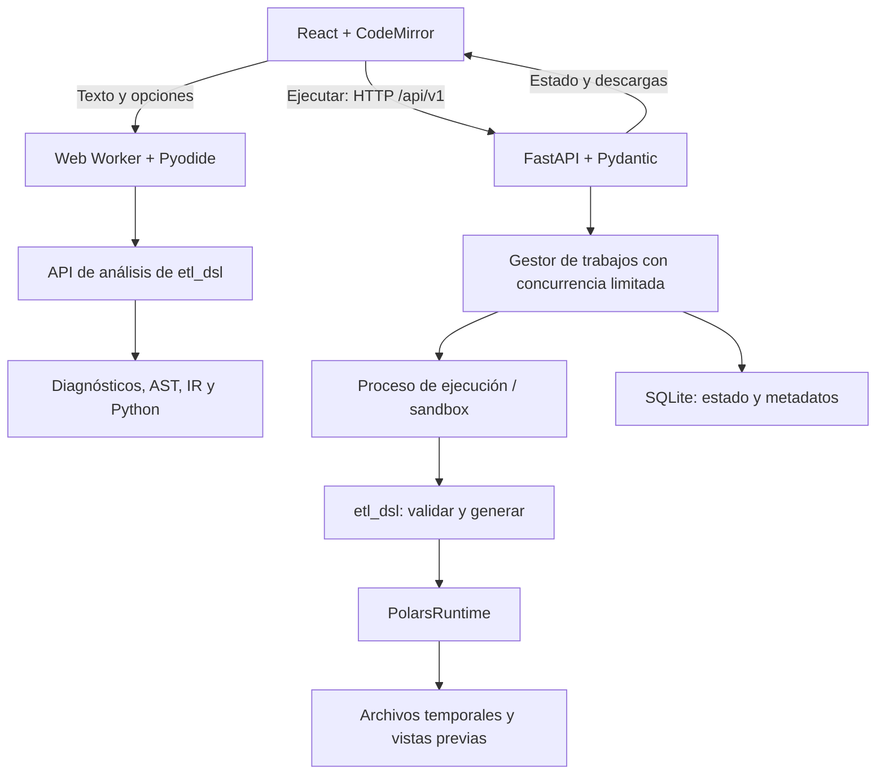

# Arquitectura propuesta de Cauce

Fecha: 11 de noviembre de 2026. Estado: **arquitectura aceptada para demo privada; implementación incremental**.

Este documento concreta la arquitectura del [plan de desarrollo](plan_desarrollo.md). El equipo ha elegido una **demo privada**, de una sola instancia, con ejemplos incluidos y ejecuciones acotadas, siguiendo las recomendaciones de este documento. Se inicia en entorno local con Docker; cuentas, carga de archivos propios y despliegue público quedan fuera de la primera entrega. Solo se elegirá un proveedor si se necesita alojar la demo privada fuera del equipo local.

## 1. Recomendación para la API

**FastAPI + Pydantic + Uvicorn, mediante HTTP REST y JSON**, con prefijo `/api/v1`.

La razón principal es reutilizar directamente el compilador y `PolarsRuntime`, escritos en Python. FastAPI ofrece validación de datos y documentación OpenAPI a partir de modelos; esto facilita mantener alineados servidor y cliente TypeScript. Véase la [documentación oficial de características](https://fastapi.tiangolo.com/features/).

| Alternativa | Evaluación para este repositorio |
|---|---|
| FastAPI | Recomendada: adaptador tipado pequeño sobre el paquete Python existente. |
| Flask | Alternativa válida; para este proyecto preferimos integrar validación y contrato OpenAPI desde el inicio. |
| Django | Lo reconsideraríamos si el producto necesitara cuentas, administración e información de negocio persistente como parte central. |
| Node/Express o una API en Next.js | No aporta una ventaja clara aquí: habría que mantener además la conexión con el runtime Python. |

Esta elección no supone que HTTP ejecute los pipelines dentro del proceso que atiende peticiones. La documentación de FastAPI distingue las tareas de fondo pequeñas del cómputo pesado que puede necesitar ejecución externa: [Background Tasks](https://fastapi.tiangolo.com/tutorial/background-tasks/).

## 2. Componentes y responsabilidades

Arquitectura de **aplicación modular en un solo repositorio**, con procesos de ejecución separados. No se requieren servicios independientes por cada fase del compilador.



| Componente | Responsabilidad | No debe asumir |
|---|---|---|
| `web/` | Documento, navegación, editor, inspectores, resultados y borradores. | La semántica del DSL ni la validez de una ruta del servidor. |
| Worker Pyodide | Compilación interactiva sin enviar el programa al servidor. | Lectura de datasets del host ni ejecución Polars. |
| `etl_dsl/` | Gramática, análisis, IR, pases, generación y runtime. | HTTP, React, usuarios o almacenamiento de trabajos. |
| `service/` | Validar peticiones, capacidades, catálogo de datos y ciclo de trabajos. | Reimplementar las reglas del lenguaje. |
| Runner | Recompilar la solicitud, ejecutar con recursos controlados y producir artefactos. | Confiar en Python generado o rutas enviados por el navegador. |
| Repositorio de trabajos | Estados, revisiones, versiones, timestamps y manifiesto de artefactos. | Guardar tablas grandes dentro de JSON o SQLite. |

El servicio depende de `etl_dsl`; `etl_dsl` no depende del servicio. Pydantic pertenece al adaptador HTTP: la API de análisis compartida debe seguir funcionando en Pyodide sin incorporar dependencias de servidor.

## 3. Contrato HTTP inicial

| Método y ruta | Comportamiento |
|---|---|
| `GET /api/v1/health` | Disponibilidad básica del proceso. |
| `GET /api/v1/capabilities` | Versiones, límites, conectores y catálogo de datasets autorizados. |
| `POST /api/v1/runs` | Valida la petición, acepta un trabajo y devuelve `202` con identificador y URL de estado. |
| `GET /api/v1/runs/{id}` | Estado, diagnósticos, revisiones, salidas disponibles y métricas medidas. |
| `POST /api/v1/runs/{id}/cancel` | Solicita cancelación; la respuesta terminal llega cuando el runner ha terminado y liberado recursos. |
| `GET /api/v1/runs/{id}/outputs/{outputId}/preview` | Vista previa paginada y acotada de una salida materializada. |
| `GET /api/v1/runs/{id}/artifacts/{artifactId}` | Descarga por identificador autorizado; nunca por ruta arbitraria. |

La cancelación es una acción distinta de borrar resultados, por eso se propone `POST .../cancel` en lugar del `DELETE` tentativo del plan anterior.

**No hace falta un endpoint HTTP de compilación para el primer estudio:** ya compila localmente. La función pública Python de C1 sirve a CLI, worker y runner. Se puede exponer después `POST /api/v1/compile` si aparece un consumidor externo o una necesidad real de fallback; no se enviará código silenciosamente al fallar Pyodide.

Una solicitud de ejecución contiene:

- `source`, `filename` lógico y pipeline seleccionado.
- Pases elegidos: `null` significa predeterminados y `[]`, ninguno; se conserva la convención actual.
- Bindings de fuentes mediante pipeline, nombre de declaración e identificador/versionado del dataset. El servidor verifica todos los enlaces, incluidos los de `USE`.
- Revisión del cliente para asociar la respuesta al documento. El servidor también calcula su propio hash del fuente y registra las opciones efectivas.

**Reglas del contrato:**

- Modelos Pydantic explícitos para entradas y salidas; generar tipos TypeScript desde OpenAPI y comprobar cambios de contrato en CI.
- Incluir versión del contrato, compilador y datasets. Un cliente incompatible puede conservar edición local, pero debe bloquear ejecución incompatible y explicar cómo actualizar.
- Diagnósticos como objetos: fase, código, mensaje, severidad, archivo lógico e intervalo. No reconstruirlos leyendo stderr.
- `422` para cuerpo u opciones inválidos; `429` si se exceden cuotas o capacidad admitida; `503` si el ejecutor no está disponible. Un error del programa aceptado se representa como trabajo `failed` con diagnósticos, no como fallo HTTP al consultar su estado.
- Diferenciar una ejecución fallida de una tabla vacía válida.
- Decimal e enteros fuera del rango seguro de JavaScript como texto acompañado por esquema; fechas en representación ISO, `NULL` como `null` y valores no finitos etiquetados. No perder precisión para dibujar la tabla.

## 4. Ejecución y almacenamiento

**Ciclo:** `queued → running → succeeded | failed | cancelled | timed_out`. La caducidad afecta a la disponibilidad de resultados y se registra por separado.

1. La API valida tamaño, opciones y datasets y registra el trabajo antes de devolver `202`.
2. Un gestor con cola acotada inicia el runner fuera del proceso HTTP; al principio, una ejecución simultánea por instancia.
3. El runner vuelve a analizar el `.etl`, resuelve bindings autorizados y genera el Python en el servidor.
4. Ejecuta con el runtime existente, materializa las salidas y produce manifiesto, esquema y vista previa. Para `OUTPUT`, el adaptador debe definir una materialización explícita; el runtime actual puede devolver un `LazyFrame`.
5. El gestor guarda el estado final y permite consultar o descargar los artefactos.

**FastAPI `BackgroundTasks` no será el ejecutor de Polars.** El gestor tendrá ciclo de vida explícito, seguimiento de procesos y cancelación. `async def` no es un mecanismo de aislamiento ni vuelve liviano un pipeline costoso.

**Persistencia recomendada:**

- SQLite para metadatos de trabajos y catálogo de artefactos, mediante una interfaz de repositorio pequeña.
- Directorio temporal por ejecución para fuente, manifiesto y salidas. Datos grandes en archivos, no en la base de metadatos.
- Borradores de código en el navegador. Sin cuentas, sincronización remota ni almacenamiento de datasets en `localStorage`.
- Al reiniciar el servicio, marcar trabajos interrumpidos como fallidos y limpiar procesos/artefactos huérfanos. No prometer reanudar automáticamente una ejecución.
- Evitar inicialmente Redis/Celery y almacenamiento de objetos. Se reconsideran si necesitamos varias instancias, trabajos durables entre reinicios o archivos compartidos entre máquinas.

Una única instancia del gestor debe ser dueña de la cola. No aumentar los workers HTTP como forma de paralelizar trabajos con estado local: los [workers de servidor son procesos separados](https://fastapi.tiangolo.com/deployment/server-workers/). La concurrencia de Polars y los recursos por trabajo también deben limitarse.

## 5. Despliegue recomendado

**Primera entrega:** una instancia del servicio Python con ejecución acotada y build estático de la web bajo el mismo origen. En desarrollo, Vite redirige `/api` al servicio; en despliegue, un proxy o el servicio entrega los estáticos y redirige las rutas de la SPA a `index.html`, conservando los errores JSON de `/api`.

FastAPI puede montar [archivos estáticos](https://fastapi.tiangolo.com/tutorial/static-files/); la recuperación de rutas de la SPA se configura aparte. Los datos de trabajos requieren volumen persistente si se quiere conservar resultados al recrear el contenedor.

El proveedor debe permitir Python, procesos de ejecución con límites, almacenamiento temporal y el aislamiento elegido. **La plataforma de despliegue sigue pendiente**; no asumir que un alojamiento de archivos estáticos cubre el runner. Fijar versiones de Python/Polars/DuckDB y publicar frontend, fuente del worker y servicio desde la misma revisión del repositorio.

### Local o privado frente a ejecución pública

- En demo local/privada, comenzar con datasets empaquetados y ejecución en proceso hijo con timeout y rutas restringidas.
- Antes de exponer ejecución públicamente, aislar sistema de archivos y red por trabajo, limitar CPU/memoria/tamaño de salidas y controlar acceso y cuota de ejecución. Un proceso hijo o un contenedor compartido por toda la API no basta por sí solo como aislamiento por trabajo.
- El servicio no acepta Python arbitrario, comandos ni rutas del host. Revisar el aislamiento del runtime además de la validación del DSL.
- No registrar el fuente ni filas de datos en logs por defecto; usar identificadores de trabajo, fase, duración y errores técnicos depurados.

## 6. Decisiones pendientes y valores recomendados

| Decisión | Recomendación de partida | Qué cambia la elección |
|---|---|---|
| Alcance de la primera entrega | Local/privada, una instancia, ejemplos incluidos. | Una demo pública requiere resolver aislamiento, abuso y acceso antes de habilitar ejecución. |
| Hosting y recursos | Entorno con contenedores y procesos largos; mismo origen web/API. | Presupuesto, memoria disponible, persistencia y soporte de aislamiento. Proveedor por elegir. |
| Datos propios | Primera versión con ejemplos. Añadir carga de CSV/Parquet después. | Necesidad de usarlos en la exposición o como producto; exige límites, ciclo de borrado y permisos. |
| Usuarios y acceso | Sin cuentas para demo privada. | Proyectos remotos, datos privados o historial compartido justifican identidad y autorización por recurso. |
| Sesión pública de demostración | Si se publica, ejemplos públicos y credencial temporal por trabajo para estado/descargas, con cuotas. | La credencial limita acceso al recurso; no sustituye aislamiento ni cuotas. Para datos privados, diseñar autenticación de usuario. |
| Límites | Probar inicialmente 30 s, 1 ejecución activa, cola máxima de 4, vista previa de 100 filas y caducidad de 1 h. | Son parámetros de prueba, no capacidad medida. Memoria, entrada y salida máximas deben fijarse tras elegir host y medir ejemplos. |
| Actualizaciones de estado | Sondeo aproximadamente cada segundo solo mientras el trabajo está activo; pausa al ocultar la pestaña. | SSE si necesitamos eventos continuos. WebSockets si aparece interacción bidireccional en tiempo real. |
| Persistencia | SQLite + archivos; borradores locales. | Varias réplicas o archivos durables compartidos justifican base/almacenamiento externos. |
| Estado del estudio | Un documento/revisión compartidos; operaciones y artefactos vinculados a esa revisión. | Colaboración simultánea requeriría resolver conflictos e identidad, fuera del alcance inicial. |
| Fuentes sin esquema | Mantener compilación sin lectura de datos; describir límites del análisis estático. | Inferir desde archivos sería una acción explícita distinta de compilar. |
| Vista por pasos | Inspección del grafo primero; vistas previas por nodo después y bajo acción explícita. | Materializar nodos puede repetir cómputo y cambiar tiempos frente al plan lazy completo. |
| Bloques visuales | Grafo de lectura; constructor editable como experimento posterior. | Resultados del prototipo de usabilidad y pruebas de ida/vuelta descritas en el plan. |

Para esta iteración quedan elegidas las opciones recomendadas: **demo local/privada**, **datasets incluidos**, **sin cuentas ni historial remoto**, sondeo de estado y persistencia SQLite + archivos al implementar el servicio. Los límites son valores iniciales que se verificarán al integrar ejecución. La tabla también registra qué cambios de alcance exigirían revisar estas decisiones.

## 7. Estructura y comprobación

```text
etl_dsl/                 # Núcleo; nueva API de análisis sin dependencias HTTP
service/
  app.py                 # Composición, configuración y ciclo de vida
  routes/                # Health, capacidades, ejecuciones y artefactos
  schemas.py             # Modelos HTTP
  jobs/                  # Gestor, repositorio SQLite y estados
  runner/                # Ejecución aislada, bindings y materialización
web/src/
  compiler/              # Worker y cliente de compilación local
  execution/             # Cliente HTTP generado/adaptado y sondeo
  workspace/             # Documento, revisiones y selección
  pages/                 # Landing, estudio, ejemplos, docs, evaluación
```

Antes de cerrar la integración: paridad de análisis CLI/worker/servidor; ejecución real de un ejemplo hasta descarga; cancelación y timeout; reinicio del gestor; salida vacía y nulos/decimales; denegación de rutas fuera del trabajo; artefactos caducados; servicio desconectado con compilación local operativa. Las pruebas del DSL existentes siguen siendo la base; el servicio suma pruebas de contrato y de ciclo de ejecución.
