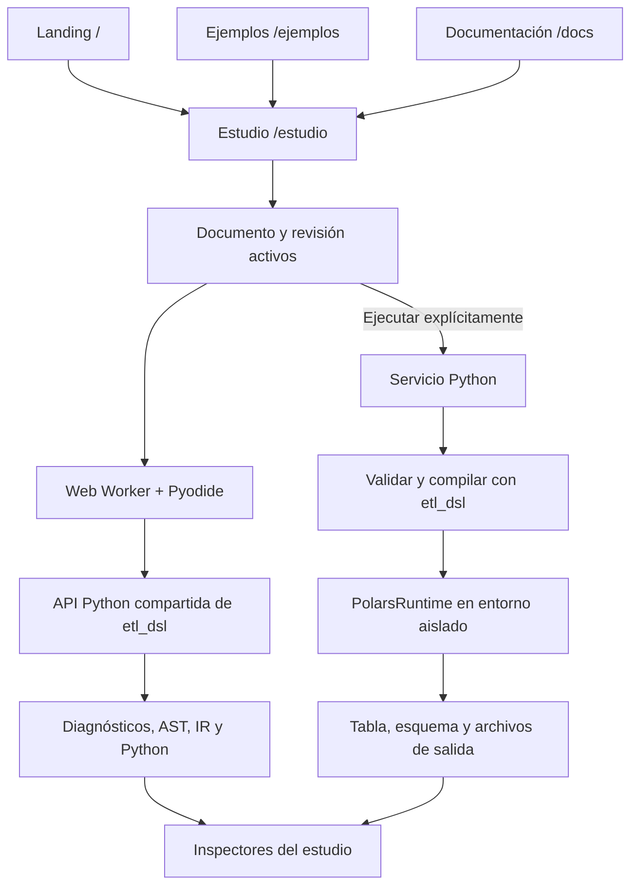

# Cauce: estado real y plan de desarrollo

Fecha de revisión: **12 de noviembre de 2026**.

Este plan parte del código actual de `etl_dsl/`, `tests/` y `web/`, y lo contrasta con [el enunciado](Enunciado_DSL.md). Cubre el compilador y la continuación de la web. C1, C2, C3, C4 y C5 están implementados. La continuación web entrega W1 (pasos A/B, paso E y su cierre con divisor de paneles y enlaces `/estudio?vista=…`), paso C/W2, W4 (robustez del worker y sugerencias semánticas del editor) y D/W3 con ejecución privada real. W1 está completo según sus criterios. La documentación final del lenguaje (`lenguaje.md`, `backend_polars.md` y el tutorial «De un CSV a un resultado» publicado en `/docs/tutorial`) está entregada; la continuación web no está completa (evaluación con usuarios pendiente; constructor por bloques fuera de alcance).

Ampliación del plan: arquitectura de conexión, páginas adicionales y evaluación de edición visual, tomando como referencia el proyecto local `csharp-x86-compi/`. Se mantiene la libertad de adaptar sus ideas al dominio ETL. La ruta `/estudio` implementa los pasos A, C y D y el cierre de W1. `/ejemplos` y `/docs` implementan el paso B y `/evaluacion` el paso E; el editor por bloques sigue pendiente.

La [definición de arquitectura de la aplicación](arquitectura_aplicacion.md) concreta API, procesos, contratos, persistencia y decisiones pendientes. Sus rutas `/api/v1` y su ciclo de trabajos sustituyen los nombres tentativos iniciales.

**Leyenda:** ✅ implementado; 🟡 parcial; ⬜ pendiente. «Implementado» describe lo observado en el repositorio, no garantiza todos los casos posibles.

## 1. Estado actual del compilador

| Área | Estado | Qué existe y dónde |
|---|---|---|
| Análisis léxico y sintáctico | ✅ | Gramática ETL-DSL v0.2, Lark LALR, scanner y posiciones: `etl_dsl/grammar.lark`, `scanner.py`, `parser.py`, `token.py`. |
| AST | ✅ | Nodos inmutables, intervalos de origen, construcción desde Lark y recorridos: `ast.py`, `visitor.py`. |
| Validación estructural | ✅ | Duplicados, enlaces y puertos, entradas requeridas, ciclos de `FLOW` y `USE`, aridad, uso de `NULL` y condiciones de JOIN: `validation.py`. |
| Diagnósticos | ✅ | Código, mensaje, fase, severidad, archivo e intervalo completo; se transportan como objetos hasta CodeMirror. `E_COLUMN` ofrece «¿quisiste decir …?» calculado en el cliente con las columnas del último análisis válido, sin cambiar mensaje ni código; los demás códigos no proponen correcciones. |
| API de análisis compartida (C1) | ✅ | `etl_dsl.analyze` recibe texto sin archivos temporales y entrega artefactos seleccionables, errores parciales y contrato JSON versionado; CLI, puente web y demos la consumen. |
| Tipos (C2) | ✅ | Inferencia conservadora de esquemas, tipos y nulabilidad en las diez operaciones; contratos OUTPUT/USE. Se mantienen chequeos de datos en ejecución. |
| IR | ✅ | DAG por pipeline, orden topológico, puertos resueltos, origen de los nodos y formato textual: `ir.py`. Las expresiones reutilizan el AST. |
| Anotaciones semánticas de la IR | 🟡 | Artefacto `schemas` de la IR original; hechos y pruebas O1 en `ir_after.module`. C4 incorpora obligaciones locales de unicidad y referencia total. |
| Optimizaciones actuales | ✅ | `constantes`, `rangos`, `filtros`, `joins` y `muertos`; selección por `--pases` y desactivación con `-O0`: `passes.py`. |
| Optimizaciones basadas en hechos del dominio | 🟡 | O1 `rangos` implementado con pruebas y procedencia. O3 `joins` implementado mediante contratos verificables. Los tres pases clásicos se agrupan como O4. |
| Generación de código | ✅ | Python legible con Polars desde la IR, expresiones y composición mediante `USE`: `backend.py`. |
| Operaciones | ✅ | `FILTER`, `SELECT`, `DERIVE`, `AGGREGATE`, `JOIN`, `SORT`, `DISTINCT`, `RENAME`, `FILL_NULL`, `DROP_NULLS`. |
| Conectores | ✅ | Lectura CSV, Parquet, SQLite y DuckDB; escritura CSV, Parquet y DuckDB: `runtime.py`. DuckDB es un conector; las transformaciones usan Polars. |
| Ejecución | ✅ | `LazyFrame`, selección de pipelines, entradas externas mediante API Python y comprobaciones en ejecución. |
| CLI | ✅ | Compilación individual y por carpetas, seis formatos, ejecución, selección de pases, rutas base y continuación del lote tras errores: `main.py`. |
| Pruebas y entorno | ✅ | Suite `unittest`, dependencias, Docker y datos de demostración. Tras la documentación final pasan **180 pruebas Python** y **52 pruebas web**; la evidencia histórica C5 conserva sus 131 pruebas. |
| Evaluación experimental | ✅ | `benchmarks/`: ocho workloads, baselines contractuales, equivalencia obligatoria, compilación/ejecución separadas y CSV/JSON/reporte. Campaña real hasta un millón de filas; [metodología y límites](evaluacion.md). |

**Distinción importante:** el compilador ya funciona de punta a punta por terminal. La brecha principal está en verificar propiedades de los datos antes de ejecutarlos y usarlas para optimizar.

## 2. Estado actual de la web

La web conserva la demo breve del landing y amplía el estudio en `/estudio`. Se verificaron con `playwright-cli` la compilación Pyodide, paridad CPython, diagnósticos, archivos, recarga, navegación y recuperación del worker. Se inspeccionaron capturas de escritorio/móvil en ambos temas; esto no es una evaluación de usabilidad.

| Funcionalidad | Estado | Evidencia y límite actual |
|---|---|---|
| Landing Cauce | ✅ | Secciones de producto, errores, optimizador, lenguaje, historia, tecnologías y preguntas: `web/src/App.tsx` y `components/`. |
| Marca y temas | ✅ | Tokens, tipografía y cambio claro/oscuro implementados en `styles/brand.css`, `index.css` y `lib/theme.ts`. |
| Editor | ✅ | CodeMirror 6, resaltado, diagnósticos, atajo para compilar y sugerencias según el contexto (columnas de la entrada de cada STEP, declaraciones y puertos en FLOW, `left.`/`right.` en ON, pipelines en USE, conectores/opciones, aridad) desde el último análisis válido: `src/editor/`. |
| Compilación real en navegador | ✅ | El mismo paquete Python corre con Pyodide y Lark dentro de un Web Worker: `src/compiler/worker.ts`. |
| Resultados iniciales | ✅ | Salidas precalculadas por el compilador real; puente compartido con el navegador: `studio.py`, `scripts/gen_compiled.py`. |
| Inspección de fases | ✅ | Resultado, tokens, árbol, AST, FLOW, IR (antes/después), esquemas y Python; vistas estructuradas del paso C con alternativa textual. |
| Compilación al editar | ✅ | Tras cargar Python, espera de 320 ms; ejemplos editables, restauración y switch de optimización: `Studio.tsx`. |
| Demostración de pases | ✅ | Comparación progresiva de constantes, filtros y pasos muertos: `Optimizer.tsx`. |
| AST y FLOW explorables | ✅ | Paso C: árbol expandible, grafo de lectura desde AST/FLOW original, pipelines, puertos, lista accesible y selección del fuente. |
| Catálogo y documentación | ✅ | Paso B: seis ejemplos, siete artículos (incluido el tutorial CSV → resultado), slugs explícitos, código de fuente canónica, anclas y copias independientes mediante el workspace. |
| Estudio ampliado | ✅ | `/estudio` con editor/inspector paralelos y divisor ajustable en escritorio (disposición en `cauce-studio-layout-v1`), alternancia móvil y enlaces `/estudio?vista=…`; el landing conserva su demo. |
| Ejecución y resultados | ✅ | Paso D: Ejecutar envía fuente y bindings al servicio Python privado, que recompila y ejecuta con Polars; tabla paginada, esquema observado, gráfico de la página y descargas. Compilar sigue siendo local; no hay despliegue público. |
| Archivos y persistencia del trabajo | ✅ | Importación/exportación `.etl`, Python vigente, revisión/pases y borradores locales versionados/validados. 128 KiB por documento, 8 anteriores, 512 KiB total; aviso si falla el guardado. |
| Robustez esencial W4 | ✅ | Cola acotada, respuestas antiguas ignoradas, validación de mensajes, errores del canal, carga 60 s/compilación 12 s y reinicio sin perder documento. |
| Evaluación C5 | ✅ | Paso E: `/evaluacion` con la campaña histórica publicada, tabla/gráfico por celda comparable, evidencia estructural, errores, descargas con hashes y comparación calculada de las fuentes medidas con las del código que la publica. |
| Build de producción | ✅ | `npm run build` pasó durante esta revisión. Esto no verifica la descarga de Pyodide ni su funcionamiento en una sesión real. |

### Decisiones que se mantienen

- Vite + React + TypeScript + Tailwind; CodeMirror 6 como editor.
- Compilación en navegador con Pyodide, conservando la carga diferida.
- Marca y tokens actuales; continuar el estudio sobre el diseño existente.
- AST, IR y Python obtenidos del compilador real, incluyendo las demostraciones.
- Sintaxis implementada `PIPELINE` / `STEP` / `FLOW` y extensión `.etl`.

El [plan inicial](planificacion.md) contiene decisiones anteriores: sintaxis en español, `.fetl`, Monaco y FastAPI. Debe leerse como historial, no como descripción del producto actual.

## 3. Prioridades

| Prioridad | Objetivo | Motivo |
|---|---|---|
| P0 | Análisis estático de esquemas, tipos y nulabilidad | Completar la verificación semántica del dominio exigida por el enunciado. |
| P0 | Dos optimizaciones del dominio con condiciones de corrección y mediciones | El enunciado exige al menos dos. Hay que justificar qué pases satisfacen ese requisito; no asumir que tres pases clásicos lo resuelven. |
| P1 | Contrato estructurado del compilador y estudio ampliado | Hacer que las fases y los errores sean explorables y coherentes. |
| P1 | Ejecución integrada y tabla de resultados | Completar el recorrido del entorno solicitado para la bonificación. |
| P1 | Benchmarks, documentación y reporte | Convertir la implementación en una entrega reproducible y defendible. |
| P2 | Gráficos avanzados, autocompletado contextual y comodidades | Mejorar la experiencia después de completar el recorrido funcional. |

## 4. Plan de implementación del compilador

### C1. API de análisis compartida y resultados estructurados — P1

- [x] Crear una API pública en `etl_dsl/` que reciba texto, nombre y pases, sin depender de `_analyze` ni de escribir un archivo temporal.
- [x] Devolver diagnósticos, AST, IR original, IR optimizada, Python y pases aplicados. Permitir solicitar artefactos para evitar trabajo innecesario.
- [x] Serializar diagnósticos con código, mensaje, severidad e intervalo completo; preservar las posiciones del AST aunque la vista decida ocultarlas.
- [x] Representar fallos por fase: un error sintáctico deja disponibles los artefactos anteriores que se hayan podido producir, sin simular un AST válido.
- [x] Hacer que CLI, `studio.py` y generador de demos consuman la misma API; mantener los formatos de texto existentes.

**Archivos:** nuevo módulo de análisis, `diagnostics.py`, `main.py`, `web/src/compiler/{studio.py,types.ts,client.ts,worker.ts}`.

**Criterio de cierre:** el mismo programa produce diagnósticos y artefactos equivalentes en CLI y puente web; CodeMirror recibe intervalos estructurados sin extraerlos de stderr con una expresión regular.

**Cerrado:** implementación en `etl_dsl/analysis.py`; contrato y comandos de verificación en [api_analisis.md](api_analisis.md). Se verificaron 70 pruebas Python, 4 pruebas del adaptador de rangos, build web y 32 comparaciones CPython/Pyodide mediante `playwright-cli`, además de corregir un diagnóstico real y comprobar rangos Unicode multilínea en CodeMirror. C2 se completó en la entrega siguiente; el servicio de ejecución sigue pendiente.

### C2. Análisis estático de esquemas y tipos — P0

- [x] Agregar un módulo semántico que recorra el DAG en orden topológico y asocie a cada salida un esquema: columnas, tipo y nulabilidad.
- [x] Partir de contratos `INPUT` y `SOURCE`; conservar un estado explícito de esquema desconocido cuando no haya contrato. Compilar debe seguir sin leer los archivos de datos.
- [x] Comprobar referencias de columnas, operandos numéricos, predicados booleanos, argumentos de funciones y agregaciones.
- [x] Propagar esquemas por selección, renombrado y columnas derivadas. Respetar el alcance de asignaciones que ya tiene el backend.
- [x] Modelar nulabilidad tras `FILL_NULL`, `DROP_NULLS` y joins externos; comprobar claves de JOIN, columnas ambiguas y contratos de `OUTPUT` y `USE`.
- [x] Ejecutar la comprobación antes de eliminar nodos para que un pase no oculte errores del programa original.
- [x] Conservar comprobaciones en ejecución para propiedades que no puedan demostrarse estáticamente.

**Archivos:** nuevo módulo semántico, `type.py`, `ir.py`, `backend.py`, `main.py`; pruebas semánticas nuevas.

**Criterio de cierre:** con un esquema conocido, `WHERE monto + 1` y una referencia a una columna inexistente fallan al compilar, con posición y explicación; un esquema desconocido no se interpreta como prueba de validez.

**Cerrado:** `etl_dsl/semantic.py` comparte reglas entre `analyze`, `build_ir` y `compile_program`; cubre las diez operaciones, esquemas parciales, nulabilidad y composición especializada de USE. El artefacto `schemas` se publica con contrato JSON 2. Ver [reglas y límites](semantica_estatica.md). Verificado con 88 pruebas Python, 4 web, build y Pyodide mediante `playwright-cli` (32 comparaciones y dos casos estáticos adicionales). No incluye C3/C4.

### C3. Hechos del dominio y optimización O1 de rangos — P0

- [x] Definir hechos conservadores por columna: intervalo, nulabilidad y procedencia de la garantía. Comenzar por hechos deducidos de filtros y literales existentes.
- [x] Propagarlos por filtros, selección y renombrado; invalidarlos cuando `DERIVE` sustituya una columna y ensancharlos conservadoramente en uniones y agregaciones.
- [x] Crear un pase `rangos`: si un filtro previo garantiza `monto >= 100`, eliminar un filtro posterior `monto >= 0` cuando esa implicación sea demostrable.
- [x] Manejar límites abiertos/cerrados y `NULL`; ante una contradicción, conservar inicialmente el filtro que produce vacío hasta tener una representación de relación vacía con esquema correcto.
- [x] Registrar qué hecho permitió la reescritura y qué nodos cambiaron.

**Dependencia:** C2. **Archivos:** módulo de hechos, `passes.py`, anotaciones de IR y pruebas.

**Criterio de cierre:** equivalencia con `-O0` en límites, nulos, ramas compartidas y columnas redefinidas; el pase solo elimina condiciones demostradas.

**Cerrado:** `facts.py` implementa hechos inmutables y el pase `rangos`, predeterminado entre `constantes` y `filtros`. Incluye procedencia, pruebas estructuradas y comentarios en IR (contrato JSON 3). Las diez operaciones y USE tienen transferencia conservadora; los límites y abstenciones están en [optimizacion_rangos.md](optimizacion_rangos.md). Verificación: 105 pruebas Python, 4 web, build, demos y Pyodide con `playwright-cli`. No incluye C4, W2 gráfico ni mediciones C5.

### C4. Optimización O3 de joins con garantías verificables — P0

- [x] Definir cómo expresar y comprobar unicidad y referencias entre tablas. Extensión implementada: `VERIFY MANY_TO_ONE` local al JOIN.
- [x] Separar restricciones declaradas de hechos comprobados; una anotación sin validar no basta para cambiar resultados.
- [x] Analizar las columnas usadas por todos los consumidores de un JOIN.
- [x] Eliminar un `INNER JOIN` únicamente si no se usa ninguna columna del lado eliminado y se garantiza una coincidencia exacta por fila: referencia total, clave única y tratamiento compatible de nulos.
- [x] Mantener las comprobaciones que sustentan esas garantías, incluso cuando el JOIN se elimine; no borrar lecturas o validaciones con efectos observables sin justificarlo.
- [x] No generalizar inicialmente a joins externos ni a claves compuestas sin pruebas específicas.

**Dependencias:** C2 y modelo de hechos de C3. **Archivos:** gramática/AST si se agregan contratos, análisis semántico, runtime, IR y pases.

**Cerrado:** `VERIFY MANY_TO_ONE` y pase `joins` con obligación ejecutable CHECK_JOIN, fronteras SELECT en todas las ramas, instantáneas materializadas y conservación de dependencias por muertos. Solo INNER con clave simple y lado derecho no observable. Contrato JSON 4. Ver [condiciones y límites](optimizacion_joins.md). Verificación de C4: 120 pruebas Python (15 C4, 120 órdenes de pases), demos, 4 web, build y Pyodide con `playwright-cli`. Las mediciones se incorporan en C5; la corrección por sí sola no implica mejora de rendimiento.

### C5. Evaluación reproducible — P1

- [x] Crear `benchmarks/` con datos de semilla fija, programas `.etl` y versiones Polars escritas a mano.
- [x] Comparar `-O0`, cada pase por separado, combinación completa y baseline manual contractual; verificar primero igualdad de resultados.
- [x] Separar tiempo de compilación y ejecución; documentar calentamiento, número de repeticiones, mediana, dispersión y entorno.
- [x] Controlar y documentar las optimizaciones de Polars para distinguir su efecto del de nuestros pases. Escenario normal y flags desactivados solo en collect finales; validaciones internas habituales.
- [x] Exportar resultados a CSV/JSON y generar tablas para expresividad descriptiva, rendimiento, impacto por pase y detección de errores.

**Criterio de cierre:** un comando reproduce datos y mediciones; los resultados reportados incluyen variación y limitaciones.

**Cerrado:** ocho workloads, siete configuraciones del compilador y baseline manual,
dos escenarios Polars; equivalencia exacta con columnas/dtypes/nulos/orden/multiplicidad,
vacíos y NaN, comprobaciones de abstención por IR y 285 errores de contratos/compilación.
Campaña real en Apple M5 Pro, cuatro hilos, semilla 20261111, 10 000/200 000/1 000 000 filas,
dos calentamientos y diez repeticiones: 4 400 muestras, 440 resúmenes y 1 024 comparaciones
previas. Ejecución incluye toda la validación C4. A un millón de filas, escenario normal,
O0/default observado: join 4.400, combinado 1.500, rangos 0.985 y clasicas 0.967;
no se afirma significancia ni mejora universal. Artefactos generados ignorados por Git.
[Comandos, cifras con IQR, costes y amenazas a la validez](evaluacion.md).
Verificación: 131 pruebas Python (11 C5), modo pequeño, campaña, demos regeneradas,
4 pruebas web, build y Pyodide con `playwright-cli`. Núcleo y contrato JSON 4 sin cambios.

## 5. Plan de continuación de la web

### W1. Estudio ampliado — P1 — ✅ completo (pasos A, B, E y cierre)

- [x] Reutilizar CodeMirror y el inspector textual (`CompilerOutput.tsx`); ampliar a `pages/StudioPage.tsx`.
- [x] Implementar `/estudio`, acceso directo, atrás/adelante, recuperación de rutas desconocidas y transferencia de una copia desde la demo.
- [x] Implementar `/ejemplos`, `/ejemplos/:slug`, `/docs` y `/docs/:slug` (paso B).
- [x] Implementar `/evaluacion` con la evidencia C5 publicada (paso E).
- [x] Requisitos restantes de la sección 9: ajuste de tamaño de paneles, enlaces `/estudio?vista=…` y auditoría de los estados del estudio (9.2). El mapa Python → DSL era condicional («si se decide»), no se decidió y no forma parte del cierre.
- [x] Mantener un documento activo en `src/workspace/`: texto, nombre, revisión, pases e inspector; ninguna selección de fase desmonta el editor.
- [x] Paneles paralelos en escritorio, alternancia Código/Inspector en móvil y estados de foco/teclado.
- [x] Diagnósticos accesibles desde cualquier fase; selección del intervalo Unicode convertido a UTF-16, multilínea y EOF.
- [x] Importación/exportación `.etl`, descarga del Python vigente y persistencia local versionada/validada con borradores anteriores recuperables.
- [x] Conservar carga diferida de editor, página ampliada y Python.

**Paso A cerrado:** editar → compilar → localizar/corregir → inspeccionar → descargar → recargar/restaurar, comprobado en navegador.
El estudio pide todos los artefactos una vez por revisión/pases; cambiar inspector no recompila. Conserva fases parciales, marca resultados
anteriores y no ofrece Python de otra revisión. En el paso A no había ejecución; la añadió D/W3. Hosting: fallback SPA en Vite/preview,
`web/public/_redirects` y ejemplo `web/nginx.conf`; el alojamiento final debe aplicar el fallback de `/estudio`.
Persistencia y recuperación detalladas en [web/README.md](../web/README.md).

**Cierre de W1:** divisor editor/inspector y enlaces internos a vistas (sección 9.2), estados del estudio auditados sin
faltantes y criterio de 9.2 cubierto con D/W3. Fuera de W1 quedaban las sugerencias semánticas (W4), el tutorial y la
documentación de lenguaje (sección 7; entregados después, ver la última entrega), la evaluación con usuarios, la comprobación del fallback en el alojamiento que se
elija y el constructor por bloques (F). Evidencia al final del documento.

### W2. Fases y optimizaciones explorables — P1/P2 — ✅ paso C

- [x] Consumir los artefactos estructurados de C1; mantener texto/JSON como vista alternativa.
- [x] Presentar IR original y optimizada lado a lado, con selector ordenable de pases y diferencias observadas; explicación estructurada de las transformaciones para las que el núcleo emite evidencia.
- [x] Agregar AST expandible y DAG de FLOW, diferenciando pipelines, puertos, entradas y salidas. Grafo de lectura determinista y lista accesible; se conservan las vistas textuales.
- [x] Enlazar nodos con posiciones del editor mediante `span` y `origin`, incluyendo los nodos fusionados.
- [x] Añadir esquemas y hechos inferidos cuando C2/C3 estén disponibles.

**Criterio de cierre:** una modificación del programa actualiza ambas IR y su Python; seleccionar un nodo lleva al fragmento que lo originó.

### W3. Ejecución y resultados — P1 — ✅ paso D

**Decisión:** mantener compilación en navegador y agregar un servicio Python para la ejecución real. Así se reutiliza `PolarsRuntime` y sus conectores sin condicionar la entrega a portar Polars/DuckDB al navegador. La ejecución enteramente local con WebAssembly queda como investigación futura.

- [x] Implementar el servicio descrito en la sección 8, comenzando por datasets de ejemplo y conservando la compilación local independiente del servicio.
- [x] Ejecutar cada solicitud en un proceso separado con directorio temporal y límites de tiempo/memoria muestreados. Para exposición pública, usar además aislamiento de sistema de archivos y red mediante un contenedor o mecanismo equivalente; un proceso separado por sí solo no restringe archivos del host.
- [x] Aceptar fuente `.etl`, opciones y referencias a datasets autorizados; recompilar en el servidor. No recibir Python arbitrario para ejecutarlo.
- [x] Añadir selección de pipeline, botón Ejecutar, estados y errores; recompilar el fuente en el servidor y conservar los contratos del runtime.
- [x] Devolver vista previa limitada de filas, esquema, nulos, duración y artefactos de `SINK`; permitir descargar resultados completos sin enviar todas las filas a la interfaz.
- [x] Mostrar tabla y un gráfico opcional de hasta 20 filas numéricas de la página cuando las columnas seleccionadas lo permitan. Separar claramente datos de ejemplo, salida precalculada y resultado recién ejecutado.
- [x] Actualizar el texto actual «tus datos no salen de tu equipo»: compilar ocurre localmente; ejecutar envía el programa y, cuando se habiliten archivos propios, los datos seleccionados al servicio.

**Criterio de cierre:** ejecutar un ejemplo genera filas y un archivo real; un archivo ausente o un contrato inválido produce un error comprensible; la interfaz sigue respondiendo durante la ejecución.

### W4. Robustez del editor y worker — P1/P2 — ✅ completo (esencial y sugerencias semánticas)

- [x] Ignorar resultados de solicitudes antiguas al cambiar texto, formato o pases; agrupar trabajo pendiente para no compilar todas las versiones intermedias.
- [x] Manejar `worker.onerror` y errores de mensajes, rechazar promesas pendientes y permitir reiniciar el worker.
- [x] Incorporar tiempo máximo y reinicio para solicitudes bloqueadas; el identificador de solicitud debe llegar hasta la actualización de la vista.
- [x] Probar pérdida de red al cargar Python, recuperación, ediciones rápidas y cambios de ejemplo durante la carga.
- [x] Mejorar después las sugerencias con columnas, pasos y puertos disponibles a partir del análisis semántico (evidencia al final: «Entrega W4 — sugerencias semánticas del editor»).

**Esencial cerrado:** resultado asociado a documento/revisión/pases; una solicitud en curso y una pendiente sustituible, promesas terminadas
al fallar/reiniciar y callbacks de workers reemplazados ignorados. Mensajes validados con contrato 4 y serialización JSON Python para conservar
`null`. Tiempo máximo de carga 60 s y compilación 12 s. Reinicio explícito conserva el documento y deja la descarga bajo acción Compilar.
Pruebas con temporizadores/canales simulados y fallo real de descarga Pyodide/recuperación, cambios durante carga y ediciones rápidas en navegador.
**Sugerencias:** contexto léxico del cursor sobre el texto actual; contenido solo del contrato 4 (`schemas`, entradas de `ir_before`,
declaraciones del `ast`) del último análisis del documento con esos tres artefactos. Si el texto cambió, se ofrece igual y se rotula
«Último análisis válido · revisión N». Pedir, recorrer o cerrar la lista no envía mensajes al worker ni recrea CodeMirror.

## 6. Orden recomendado y entregas verificables

| Entrega | Trabajo | Evidencia de cierre |
|---|---|---|
| 1 | C1 + estructura de W1 | API común y estudio ampliado mostrando las fases que ya existen. |
| 2 | C2 | Errores de columnas/tipos detectados antes de ejecutar y señalados en el editor. |
| 3 | C3 + comparación de W2 | Pase de rangos, pruebas de equivalencia y explicación antes/después. |
| 4 | C4 | Segunda optimización del dominio con garantías comprobadas y contraejemplos cubiertos. |
| 5 | W3 + robustez esencial de W4 | Recorrido completo: editar → compilar → ejecutar → tabla → descargar. |
| 6 | C5 + documentación final | Experimentos reproducibles, referencia actualizada, tutorial, reporte y demo. |

El contrato del servicio y un primer recorrido con un dataset incluido pueden desarrollarse junto con C1. Las páginas deben funcionar con las capacidades actuales, sin esperar a C2–C4: tipos inferidos y pases nuevos se incorporan cuando existan. No se asignan fechas ni responsables nuevos sin conocer la disponibilidad del equipo.

## 7. Pruebas y documentación para cerrar el proyecto

- [x] Suite actual: `.venv/bin/python -m unittest discover` — **180 pruebas, OK** (17 de evidencia C5 publicada, 4 de correspondencia de fuentes, 5 del tutorial).
- [x] Diagnósticos, revisiones, persistencia, worker, evaluación, vistas, disposición, tutorial publicado y sugerencias del editor: `cd web && npm test` — **64 pruebas, OK** (12 de sugerencias con análisis reales del puente `studio.py`).
- [x] Evidencia C5 publicada: `gen_evaluation.py --check` y recorrido `/evaluacion` con `playwright-cli` en Vite, FastAPI y Docker.
- [x] C1/C2/C3/C4 en navegador: `.venv/bin/python web/scripts/verify_browser.py` — **32 comparaciones CPython/Pyodide, dos casos C2, prueba O1, eliminación O3 con obligaciones, abstenciones y recorrido de corrección, OK**.
- [x] Build actual: `cd web && npm run build` — **OK**.
- [x] Agregar pruebas de tipos/esquemas y de propagación de nulabilidad, especialmente en JOIN y `USE`.
- [x] Probar equivalencia de los cinco pases actuales y casos donde deben abstenerse de optimizar, también en la evaluación C5.
- [x] Automatizar el recorrido local: Pyodide, transferencia desde demo, editar, corregir, fases sin recompilar, importación/exportación byte a byte, recarga, rutas y recuperación.
- [x] Completar comparación avanzada de IR (W2/paso C).
- [x] Ejecutar ejemplos desde la web hasta preview y descarga (W3/paso D).
- [x] Verificar `/estudio` en móvil y escritorio, teclado, foco, ambos temas y movimiento reducido.
- [x] Recorrido del tutorial en navegador (`verify_browser.py --tutorial-only`): artículo, enlaces, copia, error, ejecución y descarga en Vite, FastAPI y Docker.
- [x] Sugerencias del editor con teclado (`verify_browser.py --suggestions-only`, también en la suite completa): apertura, recorrido, aceptación, cero compilaciones al pedirlas y «¿quisiste decir?» en Vite, FastAPI y Docker.
- [x] Paridad CPython/Pyodide (32 presentaciones), diagnósticos y O1/O3 conservados; demos regeneradas con 157 pruebas.
- [x] Actualizar `docs/lenguaje.md` y `docs/backend_polars.md`; escribir un tutorial desde un CSV hasta un resultado ([tutorial.md](tutorial.md), `/docs/tutorial`; evidencia al final).
- [ ] Preparar reporte LaTeX de 6–10 páginas con evaluación, limitaciones, referencias y declaración de uso de IA.
- [ ] Preparar demo técnica y ensayo de explicación de todas las fases por el equipo.
- [ ] Verificar con el equipo la evidencia de las tres reuniones exigidas para la bonificación; su realización no se puede deducir del código.

**Alcance recomendado:** completar verificación estática, dos optimizaciones justificadas y el recorrido de ejecución. Dejar Excel, LSP, colaboración y visualizaciones avanzadas para después de ese cierre.

## 8. Arquitectura de conexión con el proyecto

### 8.1. Un compilador, dos entornos

Se propone extender la aplicación existente en `web/`. No crear otro frontend ni portar la semántica a TypeScript. `etl_dsl/` sigue siendo la autoridad sobre el lenguaje.

**Conexión concreta:**

1. C1 expone una función de análisis independiente de la CLI. El worker, la CLI y el servicio llaman a esa misma función.
2. El navegador obtiene los fuentes Python como hoy; el servicio utiliza el paquete instalado desde el mismo repositorio. Ambos informan una versión de compilador y de contrato para detectar despliegues incompatibles.
3. El estudio mantiene una revisión del documento. Los artefactos y ejecuciones guardan la revisión, los pases y las versiones de datasets utilizados; un cambio marca lo anterior como desactualizado.
4. Cambiar de inspector no descarta texto, selección, resultados ni posición del editor. No se compila otra vez solo por navegar si los artefactos solicitados ya están disponibles para esa revisión.
5. Ejecutar es una acción explícita. No se leen datos ni se llama al servicio por cada tecla.

### 8.2. Servicio de ejecución propuesto

Agregar `service/` como adaptador HTTP Python delgado. Se propone FastAPI para ese adaptador; el análisis y la ejecución permanecen en `etl_dsl/`. Esta elección nueva aplica al servicio de ejecución y no revierte la decisión de compilar con Pyodide.

| Interfaz propuesta | Responsabilidad |
|---|---|
| `GET /api/v1/capabilities` | Versión de compilador/contrato, conectores habilitados, límites y datasets de ejemplo disponibles. |
| `POST /api/v1/runs` | Recibir fuente, pipeline, pases y bindings de datasets; validar, crear trabajo y devolver identificador. |
| `GET /api/v1/runs/:id` | Estado, diagnósticos, versión analizada y salidas disponibles. |
| `POST /api/v1/runs/:id/cancel` | Solicitar cancelación de un trabajo activo y liberar sus recursos. |
| `GET /api/v1/runs/:id/outputs/:outputId/preview` | Consultar esquema y vista previa acotada de una salida. |
| `GET /api/v1/runs/:id/artifacts/:artifactId` | Descargar exclusivamente un archivo producido por ese trabajo mediante un identificador opaco. |

Los endpoints del diseño están implementados en el paso D; el contrato vigente y sus modelos están en [servicio_ejecucion.md](servicio_ejecucion.md). El cliente HTTP debe quedar detrás de `src/execution/client.ts`, separado del cliente de compilación.

- Primer alcance: datasets incluidos y versionados, sin cuentas ni carga pública de archivos. Los bindings identifican una declaración `SOURCE` por pipeline y nombre; el servicio sustituye su ruta por un archivo permitido y conserva las demás opciones validadas.
- Validar todas las rutas de `SOURCE`/`SINK`, incluidas las de pipelines invocados mediante `USE`; los destinos siempre quedan dentro del directorio del trabajo. No interpretar una ruta enviada por el cliente como permiso para leer el host.
- Usar ejecución en segundo plano con sondeo breve mientras la página está activa; no hace falta introducir sockets para el primer recorrido.
- Conservar temporalmente los artefactos con una política de caducidad explícita. Un enlace a una ejecución caducada explica qué ocurrió y ofrece volver a ejecutarla.
- El servicio puede estar desconectado: código, fases, ejemplos y documentación siguen funcionando; solo la ejecución muestra su indisponibilidad.
- La interfaz usa capacidades reales: SQLite solo como lectura, por ejemplo. No anunciar en la web escritura SQLite, que el compilador actual no soporta.

### 8.3. Contratos y organización del frontend

| Pieza propuesta | Contenido |
|---|---|
| `src/pages/LandingPage.tsx` | Composición actual de `App.tsx`; conserva el estudio breve de demostración. |
| `src/pages/StudioPage.tsx` | Área de trabajo completa y documento activo. |
| `src/pages/ExamplesPage.tsx` | Catálogo y detalle de ejemplos. |
| `src/pages/DocsPage.tsx` | Navegación y lectura de documentación. |
| `src/pages/EvaluationPage.tsx` | Metodología y resultados experimentales verificados. |
| `src/workspace/` | Estado de documentos, revisiones, selección y borradores; compartido por todas las vistas del estudio. |
| `src/compiler/` | Contrato de C1 y worker actual; serialización de fases, sin ejecución de datos. |
| `src/execution/` | Cliente HTTP, estados de trabajos, vistas previas y descargas. |
| `src/components/inspectors/` | Tokens, AST, FLOW, IR, optimizaciones, Python y resultados. |

Agregar enrutamiento con carga diferida por página y configurar el hosting para resolver accesos directos a rutas de la aplicación. El código del editor, grafos y estudio no debe descargarse al abrir un artículo. Los parámetros de URL guardan selección de vista/ejemplo, no programas completos ni datos personales. Los borradores pequeños pueden persistirse en almacenamiento local; datasets y resultados grandes no deben guardarse allí.

El contrato debe distinguir `no solicitado`, `disponible`, `bloqueado por error` y `no soportado`. Una fase no implementada no puede aparecer vacía como si hubiera terminado correctamente. La primera versión puede mostrar el AST expandible y la IR actual sin inventar esquemas inferidos ni reportes de pases que el compilador aún no emite.

## 9. Páginas adicionales y cómo implementarlas

### 9.1. Mapa de navegación

| Ruta | Estado | Propósito y prioridad |
|---|---|---|
| `/` | ✅ Composición y navegación a estudio/ejemplos/docs | Presentación de Cauce y demostración breve. |
| `/estudio` | ✅ Recorrido A/C/D y cierre de W1 | Editar, compilar, inspeccionar, enlazar datos autorizados, ejecutar, ver filas y descargar/restaurar documentos; divisor ajustable y `?vista=…`. |
| `/ejemplos` y `/ejemplos/:slug` | ✅ Paso B implementado | Elegir un problema ETL y abrir una copia editable. |
| `/docs` y `/docs/:slug` | ✅ Paso B implementado | Aprender a usar el lenguaje y consultar sus reglas. |
| `/evaluacion` | ✅ Paso E implementado | Consultar evidencia de expresividad, errores y rendimiento de la campaña C5 publicada. |
| `/estudio?vista=bloques` | ⬜ Candidata experimental, P2 | Evaluar edición visual más adelante; no forma parte de la implementación aprobada. Hoy `bloques` no es una vista válida: el estudio lo ignora con un aviso. |

**Decisión de navegación:** fases, datos, optimizaciones y resultados son vistas del mismo estudio, no páginas independientes que obliguen a recargar el programa. Ejemplos, documentación y evaluación sí tienen páginas porque responden a tareas distintas. No se necesita un dashboard de cuentas o proyectos para el compilador actual.

### 9.2. Estudio: `/estudio`

**Usuario y resultado esperado:** una persona que quiere transformar datos o inspeccionar la compilación. Debe poder abrir un ejemplo, editarlo, localizar un error y obtener un resultado real.

**Composición (implementada):** barra de documento con ejemplo/importación, estado de guardado, Compilar y Ejecutar; editor como área estable; inspector con vistas seleccionables; diagnósticos accesibles desde cualquier vista. En escritorio, editor e inspector en paralelo con ajuste de tamaño. En móvil, alternancia entre código e inspector sin comprimir ambos en columnas estrechas.

| Vista del estudio | Qué muestra | Implementación sobre el proyecto actual |
|---|---|---|
| Flujo | Grafo de declaraciones y conexiones del pipeline seleccionado. | Derivarlo del AST y `FLOW` originales; mostrar puertos `left/right` y `USE`. No usar la IR optimizada como representación editable del programa. Primero lectura y selección. |
| Fases | Tokens en tabla, árbol concreto y AST expandible. | Usar `scan`, `parse_tree`, AST y posiciones de C1; conservar búsqueda y vista textual. |
| Optimización | IR antes/después, pases elegidos y transformaciones observadas. | Reutilizar las ideas de `Optimizer.tsx` para cualquier documento. Inicialmente diff y recuentos reales; después trazas de pases emitidas por Python. |
| Python | Código generado y descarga. | Consumir `backend.py`; agregar mapa de origen por líneas si se desea selección código ↔ Python. Ese mapa no existe hoy y debe producirlo el generador. |
| Datos | Fuentes del programa, contratos declarados y bindings disponibles. | Extraer declaraciones del AST; unirlas al catálogo autorizado del servicio. Diferenciar contrato declarado, esquema observado e inferido estáticamente. |
| Resultados | Estado de ejecución, tabla, esquema y archivos de salida. | Consumir W3; seleccionar salida si hay varios `SINK`/`OUTPUT`, limitar vista previa y conservar tipos/nulos en la serialización. |

**Ajuste de tamaño (implementado):** divisor `role="separator"` de 44 px entre editor e inspector en escritorio (>860 px): arrastre con puntero, flechas (Mayús = 10 %), Inicio/Fin, Intro o doble clic para el 50 %; límites 30–70 % y anchos mínimos por CSS. La proporción se guarda solo en este navegador, en `cauce-studio-layout-v1` (`{version:1, editor}` validado, lectura/escritura con try/catch; si falla, dura la visita). No modifica `cauce-workspace-v1`, no recrea CodeMirror ni recompila. En móvil se mantiene la alternancia Código/Inspector sin divisor.

**Enlaces internos (implementados):** `/estudio?vista=resultado|tokens|arbol|ast|flow|ir|esquemas|python|ejecucion`. Los ocho primeros seleccionan el inspector del documento activo (solo cambia su campo `inspector`, sin revisión nueva, como al pulsar la pestaña); `ejecucion` lleva a Resultados sin cambiar nada. Un valor desconocido, repetido o con parámetros extra se ignora con un aviso visible y se conserva la vista del documento. Elegir una vista usa `replaceState`; atrás/adelante entre páginas y entre consultas de la misma ruta la recupera. La URL nunca contiene id de documento, fuente, datos, trabajos ni bindings (se descartó el identificador local propuesto antes: no se puede compartir y abre la puerta a confundir documentos); compartir un trabajo requiere exportar `.etl`. Enlazan a vistas: docs NULL/contratos → `resultado`, docs estructura → `flow` y la evidencia O1/O3 de `/evaluacion` → `ir`, siempre sobre el documento propio.

**Conexión entre vistas:** seleccionar un nodo enfoca su rango en CodeMirror y su entrada/salida en el inspector. Mantener identificadores de nodos dentro de cada revisión, posiciones completas y `origin` para fusiones; no asumir que esos identificadores sobreviven sin cambios a cualquier edición.

**Estados (auditados en el cierre de W1; todos existían, no se añadió ninguno):**

| Estado | Dónde se muestra | Verificado en |
|---|---|---|
| Documento nuevo | Estado de guardado: «Borrador nuevo. Se guardará al editar.» | `workspace.test.mjs`, `workspace.js` |
| Borrador restaurado | Estado de guardado: «Borrador restaurado en este navegador.» | `workspace.js`, `content.js` |
| Python cargando | Botón «Cargando…» y estado del compilador con progreso; fallo de descarga con reinicio | `workspace.js` (fallo real y recuperación) |
| Análisis parcial | Inspectores con artefactos `blocked`/`not_requested` y su explicación; las fases disponibles siguen navegables | `inspectors.js` (tres clases de error) |
| Error por fase | Diagnósticos con código, mensaje, línea:columna y fase; subrayado en CodeMirror | `analysis.js`, `inspectors.js` |
| Compilación lista | Etiqueta «en vivo · revisión N», «Sin errores en las fases solicitadas…», Python descargable | `workspace.js` |
| Salida desactualizada | Etiqueta «desactualizado», nota y descarga Python deshabilitada; trabajos «resultado anterior» | `inspectors.js`, `execution.js` |
| Servicio desconectado | «Servicio desconectado o sin respuesta…» con Reconectar; compilación local operativa | `execution.js` |
| Ejecutando | «En cola» / «Ejecutando» y Cancelar ejecución | `execution.js` |
| Cancelado | «Cancelado» | `execution.js` |
| Fallido | «Fallido» / «Tiempo agotado» con diagnósticos `role="alert"` | `execution.js` (JOIN fallido, timeout real) |
| Resultado vacío válido | «Salida vacía válida · 0 filas. El archivo conserva el esquema.» | `execution.js` |

El cierre solo añade el aviso de enlace con vista inválida, que no estaba en la lista.

**Criterio de cierre:** completar el recorrido con `ventas.etl`, crear un error sintáctico y corregirlo, comparar IR con/sin pases, ejecutar y descargar una salida. Cambiar de vista conserva el documento y ningún resultado antiguo se presenta como actual.

### 9.3. Ejemplos: `/ejemplos` y `/ejemplos/:slug` — ✅ paso B

**Usuario y resultado esperado:** quien aún no sabe qué escribir. Debe encontrar un caso cercano a su problema y entender qué hace antes de abrirlo.

**Contenido:** ejemplos agrupados por intención: limpieza de nulos, filtros, agregación, joins, reutilización con `USE`, optimizaciones y errores explicados. Cada detalle contiene problema, fuente `.etl`, datasets requeridos, operaciones utilizadas y acción «Abrir en el estudio».

**Implementación:**

- Manifiesto implementado en `web/content/examples.json` con slug estable, título, objetivo, ruta del fuente y requisitos. Reutilizar `scripts/programs/`, `input/` y `demo/` mediante selección explícita; no publicar automáticamente todo archivo del repositorio.
- Guardar expectativas verificables para cada ejemplo: compila, produce determinado diagnóstico o requiere un dataset concreto. Los ejemplos inválidos se identifican como ejercicios de diagnóstico.
- Mantener una sola copia del `.etl`; generar salidas de demostración con el compilador real. Las previsualizaciones precalculadas llevan esa etiqueta y no se confunden con ejecuciones en vivo.
- Abrir una copia en el estudio mediante su slug y el estado compartido. Si hay cambios sin guardar, conservar el borrador anterior antes de abrir el ejemplo nuevo.

**Disponible sin backend:** catálogo, explicación y código. **Requiere W3:** ejecutar sobre sus datasets y obtener resultados actuales.

**Criterio de cierre:** acceder directamente a un detalle, abrirlo en el estudio y comprobar que su código y datasets corresponden al ejemplo seleccionado.

### 9.4. Documentación: `/docs` y `/docs/:slug` — ✅ paso B y tutorial

**Usuario y resultado esperado:** quien necesita aprender una operación o resolver un error. Debe llegar de la explicación a un ejemplo ejecutable sin perder su borrador.

**Secciones iniciales:** primeros pasos, estructura `PIPELINE`/`FLOW`, operaciones, funciones y `NULL`, conectores, composición con `USE`, diagnósticos y límites de la compilación local. La ejecución desde el estudio la aporta el servicio privado del paso D.

**Implementación:**

- Reutilizar contenido vigente de `docs/lenguaje.md` y `docs/backend_polars.md`, con un manifiesto de artículos. Separar tutorial de referencia técnica; no publicar la planificación histórica como manual del lenguaje actual.
- Selección generada antes del build mediante `gen_content.py`; páginas cargadas en diferido con índice, anclas y código con el resaltado existente. Los seis artículos iniciales comparten un paquete pequeño de contenido.
- Enlazar fragmentos completos a ejemplos del catálogo. Un fragmento incompleto se etiqueta como tal y no ofrece ejecución directa.
- `E_NULL_COMPARISON` enlaza desde el estudio a la guía NULL/contratos y su corrección. La selección se verifica con el núcleo; un catálogo exhaustivo de diagnósticos queda fuera de este paso.
- Mostrar compatibilidad y límites: compilación sin datos, ejecución solo mediante el servicio privado (paso D), entorno Python del proyecto necesario y conectores de lectura/escritura del runtime.

**Criterio de cierre:** desde un diagnóstico del estudio se abre su explicación; desde primeros pasos se abre un ejemplo válido; Volver restaura el trabajo anterior.

**Tutorial (documentación final).** `/docs/tutorial` publica [tutorial.md](tutorial.md) completo como séptimo artículo, enlazado desde «Tu primer programa»; su programa es el ejemplo `gasto-por-cliente` (`demo/tutorial.etl`, dataset incluido `join-orders@1`). Los bloques se distinguen por lenguaje: fragmento del DSL, comando de terminal, salida obtenida y contenido CSV; los tres últimos se muestran literales y sin cortar líneas. Los artículos pueden enlazar `/estudio?vista=…` solo con vistas publicadas (`gen_content.py` falla con otra).

### 9.5. Evaluación: `/evaluacion` — ✅ paso E

**Usuario y resultado esperado:** integrante del equipo, docente o persona que quiere comprobar las ventajas del DSL. Debe poder distinguir evidencia experimental de demostraciones ilustrativas.

**Contenido:** metodología, versiones y entorno; comparación DSL/Polars manual; programas con errores; efecto por pase; tablas de tiempos y dispersión; descarga de resultados y enlace al comando reproductor.

**Implementación:** consumir JSON generado desde los resultados de C5 durante el build. Ofrecer filtros por benchmark/tamaño/pase y tabla accesible junto a cada gráfico. Publicar fecha, número de repeticiones y dispersión. La reducción de nodos se etiqueta como tal y nunca como porcentaje de aceleración.

**Dependencia:** C5. Antes de disponer de mediciones, mantener la página fuera de la navegación pública o mostrar únicamente una metodología identificada como pendiente de resultados; no llenar gráficos con datos inventados.

**Criterio de cierre:** cada valor mostrado se rastrea a un archivo de resultados y a un experimento reproducible; un benchmark ausente no aparece con tiempo cero.

**Implementado (paso E):** instantánea versionada `web/public/evidencia/c5-representativa/` con manifiesto y hashes; `gen_evaluation.py` valida y genera los datos; cada valor de la tabla procede de `summary.csv` y se comprueba en el navegador contra el CSV servido. Compilación sin tamaño ni manual; filtros por fase/programa/filas/escenario/configuración; tabla junto al gráfico. Detalle en [evaluacion.md](evaluacion.md#publicación-de-la-evidencia-y-página-evaluacion-paso-e).

### 9.6. Ajustes de la página existente y navegación

- Mantener el landing y su demostración breve. «Abrir el estudio» pasa de `#estudio` a `/estudio`; al abrir desde la demo se transfiere una copia del texto editado y los pases elegidos.
- Accesos a Ejemplos, Documentación y Evaluación (esta última desde el paso E). Se mantienen los enlaces internos del landing donde todavía aportan contexto.
- Enlaces a vistas del estudio (`/estudio?vista=…`) desde docs y evaluación; abren el documento propio en esa vista, nunca un programa ajeno. Un enlace con la misma ruta y otra consulta se resuelve con History API, sin recarga completa.
- Conservar marca, temas y tokens existentes. El estudio usa una composición orientada a operar; los artículos priorizan lectura. No trasladar animaciones de aparición del landing a cambios frecuentes del editor o tablas.
- Resolver rutas desconocidas con una página breve de «No encontrado», y ejemplos/artículos inexistentes con enlaces de recuperación.

## 10. Qué adaptar de `csharp-x86-compi`

La referencia revisada es el código local, especialmente `typescript/packages/web/src/App.tsx`, `components/Inspector.tsx`, `components/views/OptimizationView.tsx`, `lib/useProvenanceScroll.ts`, `lib/compiler-types.ts` y `backend/README.md`. No se ejecutó su aplicación durante esta revisión.

| Idea observada | Decisión para Cauce | Implementación propuesta |
|---|---|---|
| Resaltado bidireccional fuente ↔ ensamblador mediante mapa de origen. | Adaptar a fuente ↔ AST/FLOW/IR y, después, Python. | C1 conserva `span`; IR conserva `origin`; el backend debe emitir un mapa adicional para Python. Selección y navegación también accesibles por teclado, no solo hover. |
| Diff alineado antes/después y contadores de optimización. | Adaptar a IR y reporte por pase. | Comparar nodos por identidad/origen y expresiones; exponer transformaciones desde `passes.py`. Contar nodos no equivale a medir velocidad. |
| Inspector por pestañas y consola con estados por fase. | Adaptar a vistas del estudio y diagnósticos persistentes. | Contratos tipados, disponibilidad por fase y una selección compartida con el editor. |
| Ejecución explícita separada de recompilación al editar. | Adoptar. | Worker para análisis; servicio para ejecución; invalidación por revisión, pases y datasets. |
| Simulador de registros, pila e instrucciones. | No trasladar ese modelo a ETL. | Un posible inspector futuro muestra tablas por nodo materializado. Polars es lazy: seleccionar un nodo no debe fingir una ejecución secuencial ni mostrar filas sintéticas. |
| Puente Node que llama al compilador C++. | Usar una conexión propia más directa. | Servicio Python que importa `etl_dsl`, sin un proceso Node intermedio; Pyodide continúa compilando localmente. |
| Pruebas de navegador para compilación y optimización. | Adaptar los recorridos, sin copiar expectativas del lenguaje C#. | Verificar ejemplos ETL, diagnósticos, IR, revisión de resultados y ejecución Polars real. |

## 11. Evaluación de una interfaz por bloques tipo Scratch

### 11.1. Encaje con este lenguaje

**Sí merece evaluarse:** el usuario ya piensa en fuentes, transformaciones y destinos. Un bloque «Filtrar filas» con una condición visible puede facilitar el primer pipeline y evitar errores de llaves o conexiones. Esto es una hipótesis de usabilidad que debe probarse, no una ventaja medida todavía.

**Recomendación:** comenzar por un grafo de flujo de solo lectura en el estudio. Evaluar después un constructor de nodos con puertos y formularios, integrado como otra vista del mismo documento. No comprometer todavía un editor Scratch completo.

| Alternativa | Encaje | Coste y límite | Decisión |
|---|---|---|---|
| Bloques apilados como Scratch | Bueno para cadenas lineales y expresiones anidadas. | JOIN, ramas compartidas, varios destinos y `USE` necesitan conexiones adicionales; una pila deja de representar el programa completo. | No elegir como estructura principal. |
| Nodos conectados por puertos | Representa directamente el DAG de `FLOW`. | Exige resolver disposición, conexiones, formularios y navegación por teclado. | Mejor candidata para una prueba posterior. |
| Código acompañado de flujo de solo lectura | Usa el compilador actual y conserva toda la expresividad. | No elimina la escritura de sintaxis. | Primera entrega recomendada. |
| Formularios que añaden un paso a una cadena | Acceso inicial más sencillo y alcance acotado. | Solo cubre un subconjunto; debe permitir continuar en código. | Posible prototipo inicial del constructor. |

### 11.2. Cómo se integraría si se decide implementarlo

1. **Un solo documento:** el `.etl` es el formato persistido. Texto y vista visual son proyecciones de la misma revisión; ningún motor JavaScript ejecuta una semántica alternativa.
2. **Modelo visual desde el AST original:** cada declaración tiene nodo y cada conexión `FLOW` tiene arista. La IR optimizada se mantiene como resultado de análisis, porque puede fusionar o eliminar pasos que el usuario escribió.
3. **Edición mediante comandos:** añadir paso, modificar propiedad, conectar puerto o renombrar. Los comandos producen cambios transaccionales de texto y pasan por el parser/validador antes de confirmarse, con deshacer/rehacer común.
4. **Alcance inicial acotado:** una fuente CSV con esquema, `FILTER`, `SELECT`, `DERIVE`, `AGGREGATE` y un destino CSV/Parquet. Etiquetas en español; el código generado conserva las palabras clave del DSL.
5. **Expresiones:** comenzar con editor de expresión CodeMirror dentro del formulario; un sistema de bloques para expresiones es otro proyecto y queda fuera del primer prototipo.
6. **Cobertura parcial explícita:** operaciones o expresiones no editables se muestran como nodos de código y se preservan. JOIN y `USE` pueden visualizarse antes de admitir edición mediante formularios.
7. **Comentarios y formato:** preferir cambios locales por intervalos para conservar lo que no se edita. Un serializador completo AST → DSL necesitaría reglas de impresión y pruebas de ida/vuelta; el AST actual no conserva comentarios. No regenerar todo el archivo silenciosamente.
8. **Texto inválido:** mantener el último grafo válido marcado como desactualizado y bloquear sus mutaciones hasta recuperar una revisión válida. Nunca reemplazar el texto defectuoso por una versión vieja del grafo.
9. **Conexiones verificadas:** impedir ciclos y puertos ocupados de forma inmediata como ayuda, y confirmar siempre con el compilador Python. Las restricciones visuales no sustituyen `validation.py`.
10. **Accesibilidad:** añadir operaciones equivalentes a arrastrar mediante botones, lista de pasos y formularios navegables por teclado; en móvil, priorizar esa lista.

### 11.3. Cómo decidir si vale la pena

Antes de desarrollarlo completo, probar un prototipo con tareas de filtrar ventas, calcular una columna y agrupar totales. Comparar código con el constructor: finalización sin ayuda, tiempo, errores y comprensión del resultado. Incluir una tarea con ramificación para comprobar el límite de las cadenas lineales.

**Condición para avanzar:** el prototipo permite completar las tareas, conservar programas fuera del subconjunto y volver a código sin perder contenido. Si obliga a limitar el lenguaje o a mantener dos programas divergentes, conservar el flujo como visualización y posponer la edición.

**Estado de esta propuesta:** evaluada conceptualmente y registrada; no autorizada como trabajo inmediato por este plan. Las primeras páginas no dependen de ella.

## 12. Secuencia concreta para construir las páginas

| Paso | Alcance web | Dependencia | Resultado revisable |
|---|---|---|---|
| A ✅ | Enrutamiento, navegación y `/estudio` reutilizando CodeMirror y salidas textuales. | Código actual. | El landing abre un espacio de trabajo completo con borradores. |
| B ✅ | `/ejemplos` y `/docs`, detalles y acciones hacia el estudio. | Manifiestos y contenido existente. | Recorrido problema → explicación → programa editable. |
| C ✅ | API C1, estados por fase, AST expandible, FLOW de lectura y comparación de IR. | C1; C2–C4 se incorporan progresivamente. | Recorrido código ↔ fases con datos reales y posiciones. |
| D ✅ | Servicio de ejecución, bindings de ejemplos y vista Resultados. | W3 y runtime actual. | Recorrido código → ejecución → tabla → archivo. |
| E ✅ | `/evaluacion`, revisión de documentación y pruebas de navegador. | C5 para publicar métricas. | Evidencia reproducible y recorrido final comprobado. |
| Cierre W1 ✅ | Divisor de paneles, `/estudio?vista=…`, auditoría de estados y precisión de fuentes en `/evaluacion`. | A–E. | W1 completo; recorridos docs/evaluación → vista del estudio. |
| F | Prototipo de constructor visual, solo si se decide avanzar tras evaluarlo. | Documento compartido, FLOW y pruebas de ida/vuelta. | Experimento separado que no retrasa el entorno funcional. |

Este orden permite construir las páginas del compilador actual desde el paso A. El trabajo semántico P0 continúa siendo prioritario para la entrega académica, pero no es condición para ofrecer una interfaz útil sobre las funciones que ya existen.

### Evidencia de esta entrega W1-A/W4 (11 de noviembre de 2026)

- `.venv/bin/python -m unittest discover`: 132 pruebas OK; el puente prueba seis vistas conjuntas y artefactos parciales.
- `cd web && npm test`: 21 pruebas OK; `npm run build`: OK; demos regeneradas.
- `.venv/bin/python web/scripts/verify_browser.py --url http://127.0.0.1:5174/`: Vite en puerto alternativo sin detener el 5173 ajeno;
  32 comparaciones CPython/Pyodide, C2, O1/O0 y O3 con obligaciones, abstenciones y diagnósticos.
- Recorrido real `/estudio`: transferencia texto/pases, foco Unicode/multilínea/EOF, corrección, fases sin recompilar ni perder selección/scroll,
  descargas `.etl` y Python comparadas byte a byte con CPython, importación UTF-8/CRLF conservando borrador anterior, recarga e inspector restaurados,
  atrás/adelante, acceso directo y ruta desconocida, fallo de descarga Pyodide/recuperación, cambios de ejemplo durante carga y ediciones rápidas.
- Build servido con `vite preview` en 5184: acceso directo a `/estudio`, compilación real, Python vigente y consola sin errores/advertencias.
- Capturas revisadas en escritorio y móvil, claro/oscuro y movimiento reducido; navegación de diagnósticos y salida del editor con teclado.
  Los artefactos quedan en `web/.playwright-cli/`, fuera de Git. No se alteraron cifras ni archivos experimentales C5.

Siguiente entrega: inspectores avanzados del paso C; ejecución HTTP corresponde al paso D/W3. El paso B se entrega a continuación.

### Evidencia de la entrega W1-B (11 de noviembre de 2026)

Paso B implementado: `/ejemplos`, `/ejemplos/:slug`, `/docs`, `/docs/:slug`, navegación desde landing/estudio,
recuperación de slugs inexistentes y apertura explícita de copias independientes. W1 global sigue **parcial**;
`/evaluacion`, W2 gráfico, W3 HTTP/ejecución y editor por bloques no se entregan aquí.

El catálogo selecciona ventas, riesgo crediticio, ejercicio inválido NULL, rangos y JOIN verificado.
Los seis artículos iniciales cubren primeros pasos, estructura, operaciones/expresiones, NULL/contratos/diagnósticos,
conectores y composición. `web/content/examples.json` y `articles.json` son los manifiestos;
`web/scripts/gen_content.py` lee fuentes canónicas `.etl` y secciones exactas de documentación vigente.
El JSON generado incluye hashes; pruebas y `--check` detectan divergencias. No hay semántica nueva en TypeScript,
cambio del contrato 4, ampliación O1/O3 ni modificación de cifras C5.

Navegar no escribe el documento. Abrir copia usa `createDocument` y `openDocument`, conserva el anterior como borrador
y respeta los límites existentes (128 KiB/documento, ocho anteriores, 512 KiB total), con bloqueo visible al alcanzar ocho
y aviso de almacenamiento fallido. Recuperar conserva también revisión, inspector y pases `null`/`[]`.

Verificación: **137 pruebas Python**, **24 web**, `gen_content.py --check`, demos regeneradas con `gen_compiled.py`
y build. `verify_browser.py` conserva las 32 comparaciones CPython/Pyodide, diagnósticos, O1/O0, O3/obligaciones y
recorrido previo del estudio/worker. La suite nueva `content.js` verifica con `playwright-cli` acceso directo,
compilación válida, diagnóstico/corrección del ejercicio, consulta sin pérdida, recuperación de borradores,
artículo → ejemplo → estudio, copias independientes, atrás/adelante, rutas/slugs inexistentes, límites y fallo de cuota.
Se capturan índices/detalles en escritorio y móvil, ambos temas, con teclado y foco visible. El recorrido de contenido
se repite sobre `vite preview` con `--content-only`, incluidos accesos directos y compilación real del build.
No es una evaluación de usabilidad ni un despliegue realizado.

Límites: la web no lee datasets ni ejecuta Polars, y compilar no certifica datos. Los CSV de JOIN están incluidos;
los de riesgo/ventas son generables localmente; `ventas.csv` de rangos debe prepararse. El Python generado exige el
entorno del proyecto. Próxima entrega: paso C, inspectores avanzados; `/evaluacion` pertenece al paso E.

### Evidencia de la entrega paso C / W2 (11 de noviembre de 2026)

Se completa W2 según su criterio de inspección: editar actualiza ambas IR y Python, seleccionar un nodo lleva a su fuente.
W1 global sigue parcial; el criterio completo del estudio que incluye ejecución depende de W3/paso D.
No se declara completada toda la continuación web ni se altera C5 o el contrato 4.

Inspectores entregados en `web/src/components/inspectors/`: AST expandible y JSON/texto; FLOW de lectura desde AST original,
con pipeline, ramas, tipos de declaración, puertos JOIN/USE y lista accesible; comparación de IR por procedencia dentro de
una misma compilación, vistas textuales y evidencia O1/O3; esquemas originales con límites de conocimiento/tipos/nulos.
La comparación se apila por nodo en móvil. Los orígenes fusionados conservan sus selecciones individuales del fuente.
Los hechos de rangos se presentan como instantáneas del pase, separadas de esquemas originales y de la IR final.
JOIN distingue declaración, prueba estática, SELECT y obligaciones dinámicas conservadas; CHECK_JOIN no elimina la lectura derecha.
Constantes/filtros/muertos solo tienen diferencias observadas: no se inventa atribución por pase ni aceleración.

Los cinco pases tienen casillas y orden explícito (Subir/Bajar). Predeterminados/null, O0/[] y listas explícitas son estados
distintos; modificarlos crea revisión, invalida selección antigua y descarga Python. Persistencia v1 sin cambiar campos,
sin migración: ya admitía listas ordenadas; se amplía el conjunto de inspectores UI, sin confundirlo con formatos del contrato.
Una compilación solicita todos los artefactos; explorar no recompila ni desmonta CodeMirror. Los spans Unicode/multilínea/EOF
usan el adaptador existente; al seleccionar se comprueba otra vez la revisión activa. No se crea mapa Python→DSL.

Verificación: 137 pruebas Python y 31 web; contenido `--check`, demos regeneradas y build de producción.
El verificador conserva las 32 comparaciones CPython/Pyodide, diagnósticos C2, O1/O0, O3, abstenciones y recuperación del worker;
conserva los recorridos de estudio y contenido del paso B. `inspectors.js` añade ventas AST→fuente, riesgo con varios pipelines/USE,
JOIN con puertos y obligación pendiente, rangos con comparación y pruebas, pases personalizados ordenados/O0/restauración,
consulta docs/ejemplos sin pérdida, edición con resultado antiguo bloqueado, tres clases de error y recuperación,
Unicode multilínea, ausencia de recompilación al explorar, teclado/foco, móvil y ambos temas. Descargas Python O0 y personalizada
se comparan byte a byte con CPython. Los recorridos nuevos y de contenido se repiten sobre vite preview, sin imports de `/src/`.
Capturas en `web/.playwright-cli/` revisadas visualmente; no es una evaluación de usabilidad. Puertos de esta entrega: Vite 5193,
preview 5194, sin detener procesos ajenos. No se añaden dependencias al proyecto.

Límites: grafo sin edición, compilación sin ejecución/datasets, esquemas estáticos, ausencia de mapa Python-fuente,
sin trazas adicionales de pases clásicos, sin identidad de nodos entre revisiones ni persistencia remota.
Siguiente entrega: D/W3, servicio de ejecución y resultados; `/evaluacion` corresponde a E.

Los enteros fuera del rango seguro de JavaScript se advierten en los inspectores; se consultan exactos en las
vistas textuales producidas por Python y no se certifica su igualdad en la comparación estructurada.

## Entrega W1 paso D / W3 — ejecución privada y resultados reales

Implementados los siete endpoints HTTP `/api/v1` con contrato 1 independiente del análisis 4, catálogo explícito versionado, runner en subprocess y recompilación autoritativa con etl_dsl. SQLite guarda identidad/estados/manifiestos; archivos grandes y fuente temporal viven fuera de la base. El gestor limita concurrencia/cola, tiempo, RSS y archivos; cancela procesos efectivamente, limpia caducados y detecta interrupciones/huérfanos tras reinicio. No hay reanudación ni sandbox público.

El estudio reutiliza documento/revisión/pases, editor estable y compilación Pyodide. Selecciona pipeline y SOURCE/INPUT mediante datasets autorizados, cubre USE, conserva obligaciones JOIN en O0/O3 y muestra estado, diagnósticos, salidas independientes, tabla paginada, esquema físico/nulabilidad observada, gráfico opcional de la página y descargas. OUTPUT se recoge y materializa como Parquet; SINK conserva el runtime original. Cambiar opciones marca lo anterior; no ejecuta automáticamente. Solo se sondea trabajo activo con estudio/pestaña visibles. Navegar conserva referencia en memoria; recargar conserva v1 pero pierde trabajos/bindings locales. Sin datasets/resultados en localStorage ni migración del documento.

JOIN funciona con CSV incluidos; `service.prepare` prepara ventas/riesgo desde el generador canónico, rangos con su esquema específico y duplicados derechos para fallo intencional. El catálogo informa disponibilidad/hash y rechaza conectores incompatibles. El ejercicio NULL original permanece inválido y su corrección puede ejecutarse. Rutas arbitrarias del navegador y descargas por path no están admitidas.

Vite dev/preview conecta por proxy; la API entrega el build bajo mismo origen con fallback SPA y errores reales de assets/API. Docker tiene targets compiler/service y perfil local web, sin despliegue público. Dependencias de servidor aisladas en `requirements-service.txt`; tipos TS y OpenAPI generados y comprobados. Comandos, contrato, límites detallados, persistencia y semántica de salidas: [servicio_ejecucion.md](servicio_ejecucion.md).

Paso D/W3 cubre los criterios esenciales del recorrido código → ejecución → tabla → archivo. W1 **sigue parcial** por `/evaluacion`, ajuste de tamaño y otros requisitos de alcance global; el constructor por bloques, cuentas, cargas de datasets propios y colaboración no se incorporan. La siguiente entrega es E: publicar evidencia C5 en `/evaluacion`, sin modificar las cifras existentes.

**Verificación D:** 157 pruebas Python (también en Docker), 38 web, contenido/OpenAPI comprobados, demos regeneradas y builds web/Docker. `playwright-cli`: A/B/C completo y las 32 comparaciones en Vite 5177; D completo en Vite, build servido por FastAPI 8017 y build Docker 8019; contenido e inspectores también en Docker, sin imports de `/src/`. Descargas Parquet/CSV comparadas con Python; casos reales de USE, múltiples salidas, JOIN O0/O3 válido/fallido, revisión durante running, cancelación activa, timeout, desconexión con compilación local, vacío válido, navegación/persistencia v1, móvil/temas/foco. La descarga CDN de Pyodide falló en un intento de inspectores y la repetición completa pasó. Evidencia detallada en la guía del servicio; no se declara toda la continuación web completa.

## Entrega paso E — `/evaluacion` con evidencia C5 publicada

Se publica la campaña C5 `representativa` (11 de noviembre de 2026, 20:38–20:41 UTC, revisión medida
`efe13996d9201788c9fc8cd7c6f458ca68035a04`, modo measure, 10 000/200 000/1 000 000 filas izquierdas, semilla 20261111,
2 calentamientos y 10 repeticiones, 4 hilos, escenarios normal y final_flags_none). No se midió de nuevo ni se cambiaron cifras,
el DSL, O1/O3 ni el contrato JSON 4.

**Publicación reproducible.** `web/content/evaluation.json` autoriza siete archivos; `gen_evaluation.py --import-campaign`
los copia desde `benchmarks/results/representativa/` (que sigue ignorado) a `web/public/evidencia/c5-representativa/` con
`manifest.json`: campaña, recuentos, procedencia, hash y tamaño del original y del publicado, y depuraciones. Seis archivos son
copias byte a byte; `metadata.public.json` es una versión depurada que solo sustituye `environment.python_executable` (ruta del
host con usuario). Excepciones acotadas en `.gitignore` (`!web/public/evidencia/**/*.csv`) y `.dockerignore`. `benchmarks/evidence.py`
valida esquemas, tipos, unidades, celdas esperadas (56 de compilación sin tamaño/escenario ni manual; 384 de ejecución),
duplicados, ausentes, no finitos, referencias cruzadas y el recálculo exacto de las 440 celdas desde `samples.csv` con la regla
del arnés. `gen_evaluation.py` y `--check` generan/comprueban `web/src/evaluation/generated.json` de forma determinista; la
prueba de build desde una copia aislada de la instantánea y un clon limpio demuestran que no depende de archivos ignorados.

**Página.** Propósito y alcance, campaña/entorno, equivalencia previa, selector por celda comparable con tabla y diagrama de
puntos (eje desde 0), casos con y sin mejora y abstenciones, evidencia estructural con la distinción JOIN
declaración/prueba/obligaciones/tiempo, corpus de errores separado, expresividad con definición de LOC, límites, reproducción
y descargas con SHA-256 verificable. Navegación de escritorio y móvil; URL validada con fallback y aviso; atrás/adelante.
Diferida (≈57 KiB gzip), sin CodeMirror, Pyodide, cliente de ejecución ni llamadas a la API; no modifica el documento.

**Verificación.** 170 pruebas Python (también en Docker), 45 web, `gen_content`/`gen_http`/`gen_evaluation --check`, demos
regeneradas (contador 170), builds web y Docker. `playwright-cli`: suite histórica completa (A/B/C, 32 comparaciones
CPython/Pyodide) + evaluación en Vite 5201; evaluación, contenido, inspectores y D (API 8021, timeout real 8022) en Vite,
build servido por FastAPI 8021 y contenedor Docker 8023, sin imports de `/src/`. Capturas revisadas en escritorio/móvil y
ambos temas. No es una evaluación de usabilidad ni un despliegue.

**Pendientes de W1 (no abordados aquí):** ajuste de tamaño de paneles del estudio, enlaces internos `/estudio?vista=…`,
sugerencias semánticas de W4, tutorial CSV → resultado y actualización de `lenguaje.md`/`backend_polars.md` (sección 7),
evaluación con usuarios, reporte LaTeX y verificación del fallback en el alojamiento final. El constructor por bloques (F),
cuentas, datasets propios, colaboración y despliegue público siguen fuera de alcance. **No se declara completa toda la
continuación web.** Siguiente entrega sugerida: cierre de W1 (ajuste de paneles y enlaces a vistas) y documentación final.

## Entrega cierre de W1 — divisor de paneles, enlaces a vistas y precisión de `/evaluacion`

**Estudio.** Divisor `role="separator"` de 44 px entre editor e inspector en escritorio: puntero, flechas (Mayús = 10 %),
Inicio/Fin (30/70 %), Intro o doble clic (50 %), foco visible y anchos mínimos por CSS. Arrastrar solo cambia variables CSS:
CodeMirror conserva instancia, selección, scroll e historial y no se envía nada al worker. **Decisión de persistencia:** la
proporción es una preferencia de este navegador en `cauce-studio-layout-v1` (`{version:1, editor}` entero 30–70, validado,
lectura y escritura con try/catch; si falla, dura la visita). Es independiente del documento: `cauce-workspace-v1` conserva
clave y formato, sin migración. En móvil (≤ 860 px) se mantiene la alternancia Código/Inspector, sin divisor.

**`/estudio?vista=…`.** `resultado|tokens|arbol|ast|flow|ir|esquemas|python|ejecucion`; solo la vista viaja en la URL.
Las ocho primeras cambian únicamente el campo `inspector` del documento activo (sin revisión nueva, como la pestaña);
`ejecucion` lleva a Resultados. Inválido, repetido o con parámetros extra → aviso visible y vista del documento.
Elegir vista usa `replaceState`; atrás/adelante entre páginas y entre consultas de la misma ruta la recupera. `App.tsx`
ya no recarga ante un enlace interno con la misma ruta y otra consulta (antes lo dejaba al navegador). Enlaces desde el
artículo NULL/contratos (`resultado`), el de estructura (`flow`) y la evidencia O1/O3 de `/evaluacion` (`ir`), que aclaran que
abren el documento propio. Fallback SPA con consulta comprobado en Vite, `vite preview`, FastAPI (prueba unitaria y build
servido) y el ejemplo Nginx (`nginx:1.27-alpine` con `web/nginx.conf`: SPA para rutas, 404 para assets y evidencia ausentes).

**Estados de 9.2.** Auditados los doce; todos existían (tabla en 9.2). No se añadieron controles; solo el aviso de vista inválida.

**`/evaluacion`.** `compare_sources` (misma regla que el arnés, contrastada en prueba) compara `environment.source_sha256`
con el checkout; `gen_evaluation.py` guarda `sources` en el JSON y `--check` falla con la lista de fuentes si la conclusión
cambia. Resultado: **37/37 fuentes coinciden** (22 compilador, 7 arnés, 8 programas); `benchmarks/evidence.py` se añadió
después. La página lo dice así, añade que máquina, entorno y fecha son los de la campaña, y adapta «Reproducción».
Ninguna cifra ni archivo de la instantánea cambió.

**Documentación.** Se corrigieron filas y frases desactualizadas sobre D/E en este plan (ejecución ⬜, «servicio pendiente»,
«sin ejecución web», composición pendiente) y se actualizaron `README.md`, `web/README.md` y `evaluacion.md`.

**Verificación.** **174 pruebas Python** (también en Docker, 2 omitidas allí por falta de `.git` y de originales), **51 web**,
`gen_content`/`gen_http`/`gen_evaluation --check`, demos regeneradas (contador 174), build web e imágenes Docker
`compiler`/`service`. `playwright-cli`, sin detener procesos ajenos: suite histórica completa (A/B/C, 32 comparaciones
CPython/Pyodide, contenido, inspectores, evaluación) más `studio.js` en Vite 5211 (API 8031); D con la API normal y la
instancia de timeout real (8032) en Vite, en el build servido por FastAPI 8031 y en el contenedor Docker 8033; contenido,
inspectores, evaluación y estudio también en 8031 y 8033, sin imports de `/src/`. `studio.js` cubre divisor con ratón y teclado,
foco visible, límites, recarga, valor dañado y almacenamiento fallido, editor sin recrear ni recompilar (selección, scroll y
deshacer), las nueve vistas por URL, aviso de vista inválida, `replaceState`, enlace de misma ruta sin recarga, atrás/adelante,
docs → FLOW y evaluación → IR conservando documento, pases personalizados y trabajo en memoria, tabla y gráfico de Resultados a
861/1100/1440 px con 30 % y 70 %, y capturas de escritorio/móvil en ambos temas con movimiento reducido, revisadas visualmente.
Una ejecución completa en Vite falló una vez al esperar la primera carga de Pyodide (más de 65 s en «Compilando…», antes de
cualquier paso del divisor); la repetición íntegra pasó. No es una evaluación de usabilidad ni un despliegue.

**Pendiente después de W1:** sugerencias semánticas de W4, tutorial CSV → resultado y actualización de
`lenguaje.md`/`backend_polars.md`, reporte, evaluación con usuarios, verificación del fallback en el alojamiento que se elija
y, si se decide, mapa Python → DSL. Constructor por bloques (F), cuentas, datasets propios, colaboración, persistencia remota y
despliegue público siguen fuera de alcance. **No se declara completa toda la continuación web.**

## Entrega documentación final — referencia del lenguaje, backend y tutorial CSV → resultado

**Referencias vigentes.** `lenguaje.md` y `backend_polars.md` se auditaron contra `grammar.lark`, `validation.py`,
`semantic.py`, `passes.py`, `backend.py`, `runtime.py` y `main.py`, comprobando cada cambio con el compilador. Correcciones:
calificadores fuera de JOIN los rechaza el análisis estático (`E_QUALIFIER`), no el backend; el ejemplo de Python generado
mostraba un formato de etiqueta antiguo (se sustituyó por un fragmento real de `input/duckdb.etl`); `rt.step` no «lee datos»
sino que resuelve el esquema sin ejecutar el plan (en CSV puede leer cabecera y muestra), y SQLite/DuckDB se leen completos
al evaluar el SOURCE; la CLI solo guarda formatos de inspección al procesar una carpeta o con `--output`; las restricciones de
DERIVE/FILL_NULL las detecta C2 cuando el esquema se conoce. Se añadió lo que faltaba: opciones de conectores solo de cadena
(salvo `header`; números y NULL dan `E_CONNECTOR`), SQLite solo lectura, identificadores, literales numéricos, `COUNT(expr)`,
AGGREGATE sin GROUP_BY, nombres disjuntos en JOIN (`E_AMBIGUOUS_COLUMNS`, RENAME previo), lógica de tres valores (Kleene,
`SAFE_DIVIDE` con denominador nulo, claves nulas en JOIN), orden predeterminado de los cinco pases, `-O0`/`--pases`
excluyentes y con repeticiones, mensajes de `--run`, DISTINCT/DROP_NULLS en la tabla de semántica y la relación con el servicio.
Los encabezados que selecciona `articles.json` se conservaron.

**Tutorial.** [tutorial.md](tutorial.md) recorre `demo/tutorial.etl` (pipeline `gasto_por_cliente`) sobre el CSV incluido
`demo/joins_pedidos.csv`: contrato SOURCE, FILTER, DERIVE (IGV con decimal exacto), AGGREGATE y SORT, un error real
(`importes` → `E_COLUMN` en 10:15, detectado antes de leer datos gracias al contrato), compilación e inspección (estudio y
CLI), ejecución (Resultados con `join-orders@1` y `--run`) y el archivo `out/gasto_por_cliente.csv`. No requiere
`scripts/create_demo_data.py` ni `service.prepare`; el texto indica qué ejemplos sí. Publicado en `/docs/tutorial`, enlazado
desde «Tu primer programa», con el ejemplo `/ejemplos/gasto-por-cliente` (dataset declarado en `examples.json`).
`tests/test_tutorial.py` ejecuta los comandos del documento, compara sus salidas y el CSV, comprueba que cada fragmento es parte
literal del programa, que el dataset declarado es el CSV incluido del catálogo del servicio y que el servicio, con el directorio
de datasets vacío, produce la misma descarga. Una alteración del documento o del programa hace fallar las pruebas.

**Web.** Leyendas por lenguaje de bloque (fragmento del DSL, comando de terminal, salida obtenida, contenido CSV); comandos y
salidas literales, sin resaltado ni cortes de línea, enfocables y desplazables. Enlaces `/estudio?vista=…` en artículos con
vistas publicadas (falla la generación con otra). Se corrigieron dos textos desactualizados desde D: la nota de cada ejemplo
(«No hay ejecución de pipelines en la web») y la introducción de «Conectores». Sin rediseño ni dependencias nuevas.

**Verificación (12 de noviembre de 2026).** **180 pruebas Python** (también en Docker, 2 omitidas allí), **52 web**,
`gen_content`/`gen_http`/`gen_evaluation --check` (37/37 fuentes C5 coinciden: no se tocaron `etl_dsl/` ni `benchmarks/`),
demos regeneradas (contador 180), build web e imágenes Docker `compiler`/`service`. Comandos del tutorial ejecutados tal como
están escritos y servicio sin preparar (API 8044 con datasets vacíos) con descarga idéntica byte a byte a la CLI.
`playwright-cli`, sin detener procesos ajenos: suite histórica completa (32 comparaciones CPython/Pyodide, contenido,
inspectores, evaluación, estudio) más la nueva `tutorial.js` en Vite 5221 (API 8041) y `tutorial.js` en Vite 5222 contra la
API sin preparar; D con la instancia de timeout real (8042) en Vite 5221; tutorial, contenido, estudio y D en el build servido
por FastAPI (8041; tutorial también en 8044) y en el contenedor Docker (8043), sin imports de `/src/`. `tutorial.js` abre el
artículo directamente, recorre índice y enlaces (ejemplo, atrás, paginación, vistas FLOW y Resultados), abre la copia con
teclado, compila, provoca y corrige el error desde el diagnóstico, ejecuta hasta la tabla y descarga el CSV (comparado con el
runtime local), en escritorio/claro y móvil/oscuro con capturas en las cuatro combinaciones y foco visible; las capturas se
revisaron. No es una evaluación de usabilidad.

**Pendiente:** sugerencias semánticas de W4, evaluación con usuarios, reporte LaTeX, demo técnica, verificación del fallback en
el alojamiento que se elija y, si se decide, mapa Python → DSL. Constructor por bloques, cuentas, datasets propios,
colaboración, persistencia remota y despliegue público siguen fuera de alcance.

## Entrega W4 — sugerencias semánticas del editor

**Qué se sugiere y de dónde sale.** `web/src/editor/suggestions.ts` reconoce léxicamente dónde está el cursor (pipeline,
STEP y operación, cláusula, paréntesis, FLOW, USE, conector y opción) y toma el contenido solo del contrato 4: columnas de la
entrada de cada STEP desde las entradas del nodo en `ir_before` y `schemas` (IR original), con tipos posibles, nulabilidad y
conocimiento completo/parcial; `left.`/`right.` solo al empezar un lado de `ON` y, tras ellos, las columnas de ese lado; en FLOW,
productores (SOURCE/INPUT/STEP, OUTPUT de cada USE) al iniciar una conexión y destinos (STEP/SINK/OUTPUT, JOIN `.left/.right`,
INPUT de cada USE) tras `->`, desde las declaraciones del `ast`; pipelines tras `USE` (sin el propio). Conectores, opciones
(CSV `file, header, delimiter, nullstr`; PARQUET `file`; DUCKDB `file, table, schema` y `mode` solo en SINK; SQLITE `file, table`,
solo SOURCE) y aridad de funciones y agregaciones no viajan en el contrato: están en `words.ts` y una prueba los compila con el
núcleo real (deben pasar los sugeridos y fallar con `E_CONNECTOR`/`E_ARITY` los demás). No hay semántica nueva en TypeScript.

**Revisiones obsoletas (decisión).** La base es el último resultado vigente del documento con `ast`, `ir_before` y `schemas`
disponibles, junto con el texto analizado. Un resultado con errores no la sustituye y abrir otro documento la descarta. Se ofrece
aunque el texto haya cambiado (al escribir casi nunca compila), y el encabezado de cada sección lo dice: «Análisis vigente ·
revisión N» o «Último análisis válido · revisión N; el texto cambió después». Un STEP nuevo o renombrado no recibe columnas
supuestas; con esquema parcial solo se listan las conocidas, y si no hay ninguna lo explica el encabezado. La base vive en un
`StateField` (CodeMirror no se recrea) y la fuente de autocompletado no importa el cliente del compilador: pedir, recorrer o cerrar
la lista no envía mensajes al worker.

**«¿Quisiste decir …?».** Para `E_COLUMN` cuyo intervalo es exactamente el identificador (con `left.`/`right.` si lo lleva), el
cliente propone las columnas conocidas más cercanas de esa entrada como acción del diagnóstico en CodeMirror y como botón bajo
el diagnóstico en el panel. Sustituye solo ese intervalo tras comprobar que aún contiene el nombre; queda en el historial. Mensaje
y código no cambian.

**UI.** Ajuste acotado sobre la identidad existente: encabezados de sección con título y procedencia, orden del análisis,
panel de información visible (el tema lo recortaba con `overflow: hidden`, también la ayuda de operaciones previa) y apilado
encima/debajo de la lista en móvil, acción ámbar del diagnóstico y botón de 44 px bajo el diagnóstico. `impeccable detect` sobre
los archivos cambiados no marca nada nuevo (sus dos avisos son líneas anteriores) y el lint de `design-taste-frontend` conserva
sus recuentos previos. Guía `/docs/primer-programa` ampliada con «Sugerencias mientras escribes» y contenido regenerado.

**Verificación (12 de noviembre de 2026).** **180 pruebas Python** (también en Docker: 180, 2 omitidas), **64 web** (12 nuevas en
`tests/suggestions.test.mjs`: esquema completo, parcial, JOIN, USE, FLOW, conectores/aridad contra el núcleo, base obsoleta y con
errores, corrección `E_COLUMN` que vuelve a compilar y ausencia de compilaciones), `gen_content`/`gen_http`/`gen_evaluation --check`
(37/37 fuentes C5 coinciden: no se tocaron `etl_dsl/` ni `benchmarks/`), build web e imágenes Docker `compiler`/`service`. El
número de pruebas Python no cambió, así que las demos no se regeneraron. `playwright-cli`, sin detener procesos ajenos: suite
histórica completa con la nueva `suggestions.js` en Vite 5231 (API 8051): 32 comparaciones CPython/Pyodide, workspace, contenido,
inspectores, evaluación, estudio, tutorial y sugerencias; D con la instancia de timeout real (8052) en Vite; contenido, estudio,
tutorial, sugerencias y D en el build servido por FastAPI (8051) y en el contenedor Docker (8053), sin imports de `/src/`. Una
primera ejecución completa en Vite falló en `workspace.js` porque edité `src/` durante la prueba (recarga HMR registrada por
Vite); la repetición íntegra, sin ediciones, pasó. `suggestions.js` escribe en el editor real con teclado en escritorio/claro y
móvil/oscuro: lista al escribir y con Ctrl+Espacio, encabezado vigente/anterior, flechas, información visible sin tapar la lista,
aceptación, `left.` → columnas, FLOW, USE, opciones de CSV, esquema parcial, cero mensajes al worker, mismo elemento CodeMirror,
una compilación por corrección, deshacer/rehacer, acción con el puntero y botón con foco visible; capturas de la lista en las
cuatro combinaciones, revisadas. No es una evaluación de usabilidad.

**Pendiente:** evaluación con usuarios, reporte LaTeX, demo técnica, verificación del fallback en el alojamiento que se elija y,
si se decide, mapa Python → DSL. Sugerencias para otros códigos de diagnóstico no se implementaron. Constructor por bloques,
LSP, cuentas, datasets propios, colaboración, persistencia remota y despliegue público siguen fuera de alcance.

