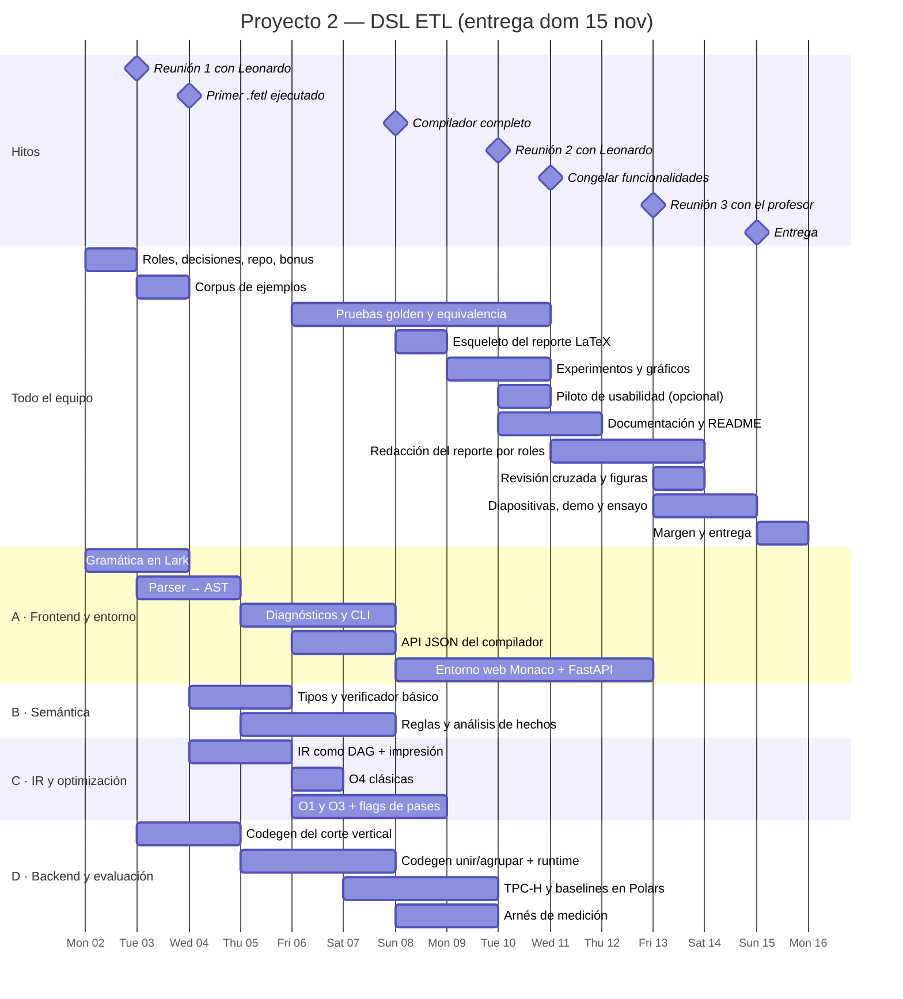

# Estado de la planificación

> Mapa de todo lo que exige el enunciado (Tipo 4) y de qué tan maduro está cada punto.
> Se actualiza a medida que se cierran decisiones.

**Leyenda**

- ✅ **Definido**: decidido y documentado; solo falta ejecutarlo.
- 🟡 **Verde**: hay un borrador o una idea, pero faltan decisiones o validación.
- ⬜ **Por planear**: todavía no se ha pensado.

---

## Resumen

| # | Área | Estado | Dónde está |
|---|---|---|---|
| 1 | Dominio y justificación | ✅ / 🟡 | `Propuesta_DSL.md` §1 |
| 2 | Trabajos relacionados | 🟡 | `Propuesta_DSL.md` §1 (tabla) |
| 3 | Sintaxis y gramática | 🟡 | `docs/diseno_lenguaje.md` §2–5 |
| 4 | Semántica | 🟡 | `docs/diseno_lenguaje.md` §6 |
| 5 | Sistema de tipos y verificaciones | 🟡 | `docs/diseno_lenguaje.md` §7, `Propuesta_DSL.md` §3 |
| 6 | Frontend del compilador (lexer, parser, semántico, diagnósticos) | ⬜ | — |
| 7 | Representación intermedia | 🟡 | `Propuesta_DSL.md` §4 |
| 8 | Optimizaciones | 🟡 | `Propuesta_DSL.md` §5 |
| 9 | Generación de código (Polars) | 🟡 | `Propuesta_DSL.md` §2 |
| 10 | Documentación del lenguaje | ⬜ | — |
| 11 | Pruebas | ⬜ | — |
| 12 | Repositorio reproducible | 🟡 | repo creado |
| 13 | Evaluación experimental | 🟡 | `Propuesta_DSL.md` §6 |
| 14 | Reporte LaTeX | ⬜ | — |
| 15 | Exposición | ⬜ | — |
| 16 | Bonificación (entorno + 3 reuniones) | 🟡 | `Propuesta_DSL.md` §7 |
| 17 | Organización del equipo | ⬜ | — |

---

## Detalle por área

### 1. Dominio y justificación — ✅ / 🟡
- ✅ El dominio ETL está aprobado por el docente.
- ✅ Público objetivo: personas no programadoras.
- ✅ Tesis: comprensible + verificado + eficiente.
- 🟡 La tesis todavía no se ha presentado en detalle al docente.
- 🟡 El "usuario tipo" no está concretado. Falta 1 o 2 personas con un escenario real (p. ej. una
  analista que consolida ventas mensuales de varios Excel), que guíen los ejemplos y el estudio
  de usabilidad.

### 2. Trabajos relacionados — 🟡
- ✅ Hay una lista de 11 papers con síntesis y un orden de lectura.
- 🟡 Nadie los ha leído todavía a fondo. Falta extraer de cada uno las decisiones de diseño, sus
  fortalezas y debilidades (lo exige el objetivo 2).
- ⬜ Fuentes nuevas que justifica el giro hacia no técnicos: lenguajes naturales controlados
  (Kuhn 2014), Gherkin, Power Query M, programación para usuarios finales (*end-user
  programming*).
- ⬜ Repartir las lecturas entre los integrantes y definir una plantilla de fichaje.

### 3. Sintaxis y gramática — 🟡
- ✅ Estilo: español, bloques con llaves, pasos con nombre y operadores simbólicos.
- 🟡 EBNF v0.1 escrita, pero **no se ha probado en Lark** (puede haber conflictos LALR).
- 🟡 Decisiones abiertas (diseño §8):
  1. Columnas de Excel con espacios.
  2. Celdas vacías en columnas sin regla.
  3. Nombres repetidos al `unir`.
  4. `??` frente a `si_vacio`.
- ⬜ **Corpus de ejemplos** (≈10 válidos y ≈10 con errores), escrito *antes* de implementar.
- ⬜ La extensión de archivo (`.fetl`) y el nombre del lenguaje están sin decidir.

### 4. Semántica — 🟡
- ✅ Hay una tabla con cómo transforma el esquema cada operación, y está definido que los pasos
  son inmutables y se evalúan de forma diferida.
- 🟡 Falta precisar casos borde:
  - ¿`ordenar` es estable?
  - ¿Cómo se comparan los vacíos al ordenar?
  - ¿`unir` sin `izquierda` es siempre un join interno?
  - ¿Qué pasa si `calcular` reemplaza una columna que usa una regla?
- ⬜ Una presentación "formal" para el reporte: reglas de inferencia o una semántica denotacional
  ligera de cada operación sobre tablas.

### 5. Sistema de tipos y verificaciones — 🟡
- ✅ Hay tipos, nulabilidad, reglas numéricas, agregaciones y funciones del MVP.
- 🟡 **Inferencia de esquemas desde archivos**: cuántas filas se leen al compilar, cómo se
  infiere en CSV frente a Excel, y qué pasa si el archivo no existe al compilar.
- ⬜ **Análisis de hechos**: cómo se representan los rangos y conjuntos de valores, y cómo se
  propagan por `filtrar`, `calcular` y `agrupar`. Es la base de las verificaciones y de O1–O3.
- ⬜ Qué reglas se verifican en ejecución y cómo se reporta un fallo al usuario no técnico.

### 6. Frontend del compilador — ⬜
- ✅ Herramienta: Python + Lark.
- ⬜ El formato de los diagnósticos: código de error, línea y columna, fragmento subrayado,
  sugerencia.
- ⬜ ¿Se reporta solo el primer error o varios (recuperación de errores)?
- ⬜ El catálogo de mensajes de error en español (sirve también para la documentación).
- ⬜ La interfaz de línea de comandos:
  - `fetl compilar`
  - `fetl ejecutar`
  - `fetl verificar`
  - `fetl inferir`
  - flags `-O0` y `--pases`

### 7. Representación intermedia — 🟡
- ✅ Será un DAG de operadores relacionales anotados con esquema y hechos.
- 🟡 Solo existe la lista de nodos.
- ⬜ Falta definir:
  - La estructura exacta de los nodos.
  - Cómo se baja del AST a la IR.
  - Si se manejan expresiones dentro de la IR o como árboles aparte.
- ⬜ Un **formato textual de la IR** para imprimirla. Se necesita para la depuración, el
  reporte y la visualización "antes y después" del bonus.

### 8. Optimizaciones — 🟡
- ✅ Elegidas: O1 (rangos), O2 (verificaciones redundantes), O3 (eliminación de joins) y
  O4 (clásicas).
- ⬜ El algoritmo de cada pase y su **condición de corrección**. Por ejemplo, O3 solo es válida si
  la `referencia` está garantizada y el join es interno.
- ⬜ Diseñar un benchmark donde cada pase tenga un efecto medible.
- ⬜ Comprobar en Polars qué hace ya su optimizador, para no medir dos veces lo mismo.

### 9. Generación de código — 🟡
- ✅ Destino: Python + Polars en modo lazy, con código legible.
- 🟡 Solo hay un ejemplo traducido a mano.
- ⬜ Una tabla de traducción de cada operación y expresión del DSL a Polars.
- ⬜ Un pequeño **runtime** para las verificaciones en ejecución y los mensajes en español.
- ⬜ Excel: ver las dependencias (`fastexcel` y `xlsxwriter`) y la falta de lectura diferida.
- ⬜ Fijar la versión de Polars y comprobar su API (`validate=`, `sink_*`, flags del optimizador).

### 10. Documentación del lenguaje — ⬜
- ⬜ Especificación de referencia: se puede derivar de `diseno_lenguaje.md`.
- ⬜ Guía de uso para no técnicos, tipo tutorial paso a paso.
- ⬜ Programas de ejemplo del dominio: se pueden reutilizar los del corpus.

### 11. Pruebas — ⬜
- ⬜ Estrategia general: pytest más tres tipos de prueba.
  - Archivos "dorados" (*golden files*) para el código generado y la IR.
  - Snapshots de los mensajes de error.
  - Pruebas de equivalencia: el resultado con `-O0` debe ser igual al optimizado, e igual al de
    Polars escrito a mano.
- ⬜ Casos límite: archivos vacíos, columnas todas vacías, tildes y Unicode, tipos mixtos en CSV.

### 12. Repositorio reproducible — 🟡
- ✅ Repo público en GitHub, con commits convencionales.
- ⬜ La estructura de carpetas (`compilador/`, `tests/`, `ejemplos/`, `benchmarks/`,
  `reporte/`, `docs/`).
- ⬜ El gestor del entorno (uv o Poetry) y las versiones fijadas.
- ⬜ README con las instrucciones para instalar, compilar, ejecutar y replicar.
- ⬜ Integración continua (GitHub Actions con las pruebas): opcional, pero ayuda.

### 13. Evaluación experimental — 🟡
- ✅ Los 5 aspectos están cubiertos y los datos serán TPC-H más datos sintéticos.
- ⬜ Cuáles son los programas de benchmark y sus versiones Polars escritas a mano (*baselines*).
- ⬜ El arnés de medición: corridas, calentamiento, memoria pico, exportar a CSV y gráficos.
- ⬜ La definición precisa de las métricas de expresividad: qué cuenta como "construcción".
- ⬜ **Estudio de usabilidad**:
  - Participantes (¿cuántos y de qué carreras?).
  - Tareas y grupo de comparación (Python/Pandas o Power Query).
  - Consentimiento.
  - Cuestionario SUS.
  - Duración.

### 14. Reporte LaTeX — ⬜
- ✅ Las secciones mínimas están dadas por el enunciado.
- ⬜ Elegir la plantilla (acmart SIGPLAN o IEEE) y crear el esqueleto en `reporte/`.
- ⬜ Asignar responsables por sección.
- ⬜ Llevar un registro del uso de IA, porque el reporte debe declararlo.

### 15. Exposición — ⬜
- ⬜ El guion de la demo: qué problema del dominio se resuelve en vivo.
- ⬜ El reparto entre integrantes. Todos deben poder explicar cualquier parte; si alguno no
  puede, la nota es 0.

### 16. Bonificación (+3 en el examen final) — 🟡
- ✅ **Se va por el bonus** con un **entorno web propio**, no con una extensión de VS Code.
  - Backend: FastAPI, que llama directamente al compilador en Python.
  - Frontend: una sola página con el editor **Monaco** cargado desde CDN.
    - Resaltado de sintaxis con un tokenizador Monarch.
    - Errores léxicos, sintácticos y semánticos subrayados con `setModelMarkers`.
    - Paneles de AST (árbol), IR antes y después de optimizar, código Polars generado, y
      ejecución con tabla de resultados (y un gráfico simple).
- ✅ Responsable: rol A, del dom 8 al jue 12, cuando el parser y los diagnósticos ya estén listos.
- ⬜ **Contrato JSON del compilador** (vie 6): una función `compilar(texto) →
  {diagnosticos, ast, ir_antes, ir_despues, codigo}` y una `ejecutar(...)`. Lo deben respetar
  los roles A, C y D desde el principio, para que el entorno solo tenga que mostrar los datos.
- ⬜ **Agendar las 3 reuniones**:

  | Reunión | Fecha tentativa | Qué se presenta |
  |---|---|---|
  | 1 — Leonardo | mar 3 | Tesis, gramática y corpus |
  | 2 — Leonardo | mar 10 | Compilador completo, optimizaciones y prototipo del entorno |
  | 3 — Profesor | vie 13 | Entorno completo y resultados de la evaluación |

**¿Por qué no la extensión LSP?**
- Exige programar en dos lenguajes: el cliente en TypeScript y el servidor en Python (pygls).
- Exige autocompletado y navegación entre definiciones, que el entorno propio no pide.
- Igual hay que construir vistas web dentro de VS Code para el AST y la IR.
- El público objetivo no usa VS Code: un entorno web sirve también para el estudio de
  usabilidad y para la demo.

### 17. Organización del equipo — ⬜
- ⬜ Los integrantes y sus roles. Que cada uno sea responsable de una fase del compilador hace
  visibles las contribuciones.
- ⬜ El flujo de git: ramas por funcionalidad, PRs revisados por otro integrante y commits
  convencionales.
- ⬜ El **calendario**: fechas de entrega, de exposición y de las reuniones.
- ⬜ Las herramientas de seguimiento (issues de GitHub, ClickUp…).

---

## Riesgos identificados

| Riesgo | Mitigación |
|---|---|
| **Solo hay ~2 semanas** | Corte vertical el miércoles 4, congelar funcionalidades el miércoles 11 y recortar el alcance (ver arriba) |
| El optimizador de Polars "oculta" el efecto de O1–O4 | Medir con Polars encendido y apagado; priorizar O1 y O3, que Polars no puede hacer |
| Conflictos en la gramática LALR por la sintaxis cercana al lenguaje natural | Probar la EBNF en Lark cuanto antes y mantener la regla de que cada instrucción empieza con un verbo |
| No conseguir participantes no técnicos para el estudio de usabilidad | Reclutar pronto; un estudio pequeño (5–10 personas) bien descrito es aceptable |
| Contribuciones desiguales en el equipo (nota 0) | Repartir la responsabilidad por fases y hacer que todo pase por PR revisado |
| El soporte de Excel (dependencias, lectura no diferida) complica el backend | El MVP usa solo CSV y Parquet; Excel entra en la fase 3 |

---

## Plazo: ~2 semanas (2–15 nov 2026)

Con este plazo, la regla es: **primero un compilador completo de punta a punta, aunque sea
pequeño, y después se amplía**. Nada se pule hasta que el pipeline `.fetl → Polars` funcione.

### Recorte de alcance

| Entra (mínimo del enunciado) | Se recorta o se pospone |
|---|---|
| Gramática, parser, AST y diagnósticos en español | Recuperación de varios errores: se reporta solo el primero |
| Tipos, nulabilidad, `reglas` (rango, `uno_de`, `unico`, `referencia`) | Comando `inferir` y Excel: **solo CSV y Parquet** |
| `fuente`, `paso`, `filtrar`, `seleccionar`, `quitar`, `calcular`, `unir`, `agrupar`, `ordenar`, `guardar` | `renombrar`, `unir izquierda`, reglas sobre pasos |
| IR como DAG con formato textual imprimible | Semántica formal completa: solo reglas de inferencia de las operaciones clave |
| **O1** (rangos) + **O3** (joins) + O4 (clásicas, barata) | O2 (verificaciones redundantes): solo si sobra tiempo |
| Codegen Python + Polars con verificaciones en ejecución | CI con GitHub Actions |
| Evaluación: expresividad, rendimiento, impacto de optimizaciones, detección de errores | Usabilidad: un **piloto de 3–5 personas** o se omite (el enunciado la marca opcional) |
| Reporte de 6–10 páginas, documentación, exposición | — |

**Bonificación: se va por ella** (hasta +3 en el examen final). Se hará con un entorno web
propio (ver área 16). Las 3 reuniones se piden el lunes 2.

### Roles (para 4 integrantes)

| Rol | Responsable de | Sección del reporte |
|---|---|---|
| A — Frontend y entorno | Gramática Lark, parser, AST, diagnósticos, CLI, **entorno web del bonus** | Diseño del lenguaje (sintaxis) |
| B — Semántica | Inferencia de esquemas, tipos, reglas, análisis de hechos | Diseño del lenguaje (tipos y verificaciones) |
| C — IR y optimización | AST → IR, impresión de la IR, O1/O3/O4 | Implementación (IR y optimizaciones) |
| D — Backend y evaluación | Codegen Polars, runtime, benchmarks, arnés de medición | Implementación (codegen) y Evaluación |

Con 3 integrantes, B y C se fusionan. Todos escriben pruebas de su parte, y la introducción,
los trabajos relacionados y las conclusiones se reparten. Todo entra por PR revisado por otra
persona, para que la contribución de cada uno quede registrada y todos conozcan el código ajeno.

### Calendario

| Día | Objetivo del día | Hito |
|---|---|---|
| **Lun 2** | Roles; cerrar las 4 decisiones del diseño; esqueleto del repo y entorno; decidir el bonus y pedir las reuniones | Repo listo |
| Mar 3 | Gramática en Lark sin conflictos; corpus de ejemplos (≈10 válidos y ≈10 con errores) | El parser acepta todo el corpus válido |
| Mié 4 | **Corte vertical**: `fuente/filtrar/seleccionar/calcular/guardar` de punta a punta | 🎯 El primer `.fetl` genera Polars que se ejecuta |
| Jue 5 | Tipos y diagnósticos; `unir`, `agrupar`, `ordenar`; IR como DAG | |
| Vie 6 | `reglas` + análisis de hechos; verificaciones en ejecución | El corpus con errores se detecta |
| Sáb 7 | O1, O3, O4 con flags `-O0` / `--pases`; impresión de la IR | |
| Dom 8 | Pruebas de equivalencia y golden files; esqueleto LaTeX; datos TPC-H | 🎯 **Compilador completo** |
| Lun 9 | Benchmarks y baselines en Polars; arnés de medición | |
| Mar 10 | Experimentos de expresividad y detección de errores; piloto de usabilidad si se hace | Tablas y gráficos listos |
| **Mié 11** | **Congelar funcionalidades**. Documentación del lenguaje y README reproducible | 🎯 Repo final |
| Jue 12 | Reporte: cada rol escribe sus secciones | Primer borrador completo |
| Vie 13 | Revisión cruzada del reporte; figuras; declaración del uso de IA | |
| Sáb 14 | Diapositivas y demo; **ensayo: cada uno explica una parte que no hizo** | |
| Dom 15 | Margen y entrega | 🎯 Entrega |

La entrega es el **domingo 15 de noviembre**.

### Gantt

